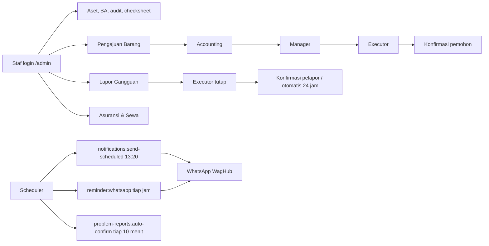
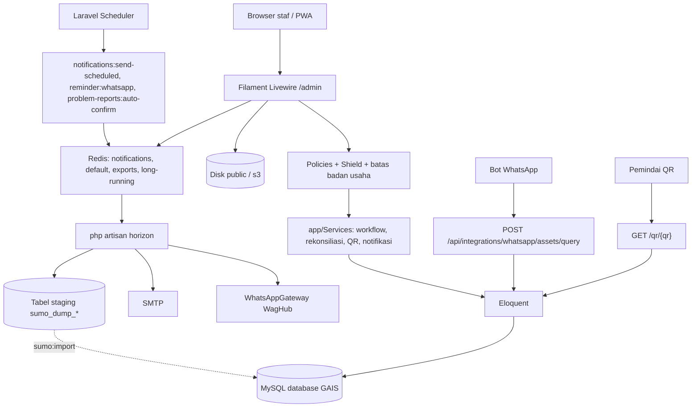

<p align="center">
  
</p>

<h1 align="center">GAIS</h1>

<p align="center">
  <strong>General Affair Information System</strong><br>
  Satu panel untuk pekerjaan General Affair: inventaris aset, berita acara,
  audit dan checksheet, pengajuan barang, lapor gangguan, serta asuransi dan sewa.
</p>

GAIS menggabungkan dua aplikasi internal yang dulu berjalan terpisah:

| Asal | Yang dibawa | Grup menu di GAIS |
|---|---|---|
| **Shelf** (kode asli repo ini) | Inventaris aset, transfer dan berita acara, rekonsiliasi audit, checksheet kendaraan dan OB, pekerjaan vendor, pengingat dokumen, QR aset | Aset, Master Aset, OB / Kebersihan, Kendaraan, Pekerjaan Vendor, Organisasi |
| **sumo-web** ("Web Gais lama") | Pengajuan barang, lapor gangguan, asuransi dan perjanjian sewa, master barang, QR pengajuan/barang, notifikasi WhatsApp | Pengajuan Barang, Lapor Gangguan, Asuransi & Sewa, serta Pengaturan > Notifikasi WA dan Impor Data Sumo |

Modul sumo-web dibangun ulang sebagai resource Filament di repo ini, bukan ditempel sebagai aplikasi lain. Data lamanya dipindahkan sekali lewat **Pengaturan > Impor Data Sumo** (atau `php artisan sumo:import`); setelah itu sumo-web tidak perlu dijalankan lagi. Repo GitHub sudah di-rename menjadi `oceanspacedev/gais-web`, dan production memakai nama GAIS: domain `gais.oceanspace.co.id`, database `db_gais`, bucket S3 `gais`, folder server `/var/www/gais-web`.

Semua dipakai lewat satu jalur: **panel staf Filament di `/admin`**. Di luar panel hanya ada halaman QR aset publik, unduhan PDF/label untuk user terautentikasi, dan endpoint integrasi WhatsApp.

Bahasa utama aplikasi adalah Bahasa Indonesia (locale `id`) dan seluruh perhitungan waktu memakai zona waktu `Asia/Jakarta`.

> [!IMPORTANT]
> Dua rute berjalan tanpa autentikasi: `POST /api/integrations/whatsapp/assets/query` (query aset untuk bot WhatsApp) dan `GET /qr/{qr}` (halaman QR aset yang mencatat pemindaian dan lokasi). Jangan membuka keduanya ke internet tanpa kontrol jaringan dan jangan menambahkan data sensitif ke responsnya. Reset password dan halaman profil panel Filament dimatikan (`passwordReset(null, null)`, `profile(null)`).

## Daftar isi

- [Tujuan dan scope](#tujuan-dan-scope)
- [Fitur utama](#fitur-utama)
- [Role dan hak akses](#role-dan-hak-akses)
- [Cara kerja aplikasi](#cara-kerja-aplikasi)
- [Arsitektur](#arsitektur)
- [Tech stack](#tech-stack)
- [Persiapan development](#persiapan-development)
- [Konfigurasi environment](#konfigurasi-environment)
- [Menjalankan aplikasi](#menjalankan-aplikasi)
- [Workflow development](#workflow-development)
- [Testing dan quality check](#testing-dan-quality-check)
- [Batasan dan technical debt](#batasan-dan-technical-debt)
- [Troubleshooting](#troubleshooting)

## Tujuan dan scope

GAIS adalah sumber data tunggal tim General Affair: siapa memegang aset apa, dokumen BA mana yang menyertainya, apa hasil audit stok dan kendaraan, pengajuan barang apa yang sedang berjalan, gangguan apa yang dilaporkan, dan kontrak asuransi/sewa mana yang akan jatuh tempo.

### Termasuk dalam scope

- `GET /` mengarah ke panel `/admin`.
- Panel Filament dengan sepuluh grup menu (lihat [Fitur utama](#fitur-utama)), dashboard dengan widget statistik aset dan ringkasan modul sumo, halaman **Panduan** untuk semua user, dan halaman **Dokumentasi Teknis** (dirender dari [`docs/dokumentasi-teknis.md`](docs/dokumentasi-teknis.md)) untuk developer.
- Login panel dengan username atau email, OTP WhatsApp, atau kode/magic link email. Registrasi mandiri, reset password, dan profil default Filament dimatikan.
- Unduhan PDF berita acara dan penyelesaian tugas, cetak label QR aset, QR pengajuan, dan QR barang (semua butuh login).
- Halaman QR aset publik `GET /qr/{qr}` yang menampilkan aset dan mencatat pemindaian beserta lokasi.
- Command terjadwal: pengingat dokumen aset, pengingat sewa/asuransi/cutoff pengajuan, konfirmasi otomatis laporan gangguan, snapshot Horizon, dan `model:prune`.
- Gateway WhatsApp WagHub (`WAG_URL` + `WAG_TOKEN`) untuk notifikasi, pengingat, dan OTP login.
- Query aset dari bot WhatsApp: `gais.search_asset`, `gais.asset_history`, `gais.expiring_documents`.
- Impor data legacy sumo-web dari panel atau CLI, idempoten.
- Import user hanya dari JSON Talenta; import Excel untuk aset, produk, asuransi, sewa, dan checksheet kendaraan.
- Health check Laravel di `/up`; Horizon, Pulse, dan Log Viewer untuk pemegang permission observability.

### Di luar scope implementasi saat ini

- Aplikasi mobile terpisah; staf memakai panel Filament (tersedia sebagai PWA).
- Produk REST API domain. `routes/api.php` hanya mengekspos `GET /api/user` (Sanctum) dan query aset WhatsApp.
- Form publik untuk pengajuan atau laporan. Modul Pengajuan Aset lama (pengadaan/penarikan/perbaikan dengan token approval) sudah dihapus; penggantinya adalah Pengajuan Barang di dalam panel.
- Pembuatan role `general_affair` dan `admin`; keduanya dibuat manual oleh super admin.
- Pipeline CI/CD, image container, atau orkestrasi Compose di repositori ini.

## Fitur utama

Menu panel dikelompokkan per modul; urutan grup diatur di `AdminPanelProvider::navigationGroups()` dan dijaga `NavigationGroupsTest`.

| Grup menu | Menu | Asal | Keterangan |
|---|---|---|---|
| Aset | Aset, BA (asset transfers), servis aset, Import & Laporan Audit Aset, History Label QR | Shelf | Kondisi aset: Tersedia, Digunakan, Dijual, Hilang, Rusak; NBH pending/selesai. Pencarian daftar aset ikut mencocokkan atribut kustom (plat, serial number, IMEI) |
| Master Aset | Kategori, merek, vendor, atribut kustom, pintasan Lokasi | Shelf | Atribut kustom bertipe dokumen jadi sumber pengingat masa berlaku |
| OB / Kebersihan | OB Checksheets, Ruangan OB, Shift OB, pintasan Lokasi | Shelf | Checklist kebersihan per shift dan ruangan, foto bisa diperbesar, export Excel |
| Kendaraan | Checksheet kendaraan | Shelf | Import/export checksheet kendaraan per plat |
| Pekerjaan Vendor | Tugas vendor | Shelf | PDF penyelesaian tugas vendor |
| Pengajuan Barang | Pengajuan, Scan QR Pengajuan, barang (produk), kategori barang, satuan, tipe pengajuan, pengaturan periode pengajuan, log pengajuan, Scan QR Barang | sumo-web | Alur Accounting → Manager → Executor → konfirmasi pemohon; setiap perubahan status tercatat di log; ekspor Excel Rekap per Divisi dan Master QR; impor barang dari template dan ekspor semua barang dengan kolom yang sama |
| Lapor Gangguan | Laporan gangguan, jenis gangguan | sumo-web | Satu laporan terbuka per pelapor; konfirmasi otomatis 24 jam setelah ditutup; ekspor laporan per rentang tanggal dengan kolom sumo |
| Asuransi & Sewa | Asuransi, sewa, penyedia asuransi, kategori asuransi, cakupan asuransi | sumo-web | Riwayat perubahan kontrak di tab Updates; pengingat jatuh tempo via WhatsApp; impor dari template dan ekspor semua kontrak dengan kolom yang sama, plus impor/ekspor baris pembaharuan per kontrak |
| Organisasi | Users, badan usaha, divisi, area, jabatan, lokasi | Shelf | Halaman user punya tab Aset Dipegang, BA, Pengajuan Barang, Approval Pengajuan, Laporan Gangguan. Import user hanya dari JSON Talenta; ekspor Excel user (kolom sumo) untuk pemegang `export_user` |
| Pengaturan (collapsed) | Roles (Shield), site/PWA settings, Notifikasi WA, Impor Data Sumo, Exceptions, tautan Horizon dan Log Viewer | campuran | Tiap item dijaga permission masing-masing |

Di luar grup: **Dashboard** (widget statistik aset, Overlook, dan sepuluh widget modul sumo), **Panduan** (`/admin/panduan`, semua user yang login), dan **Dokumentasi Teknis** (`/admin/dokumentasi-teknis`, permission `View:TechnicalDocs`).

Surface di luar panel:

| Surface | Rute | Auth |
|---|---|---|
| Unduh PDF BA / penyelesaian tugas | `GET /asset-transfer/{id}/download`, `GET /task-completion/{id}/download` | `auth` + policy `view` |
| Cetak label QR aset | `GET /assets/{asset}/qr-label/print`, `GET /assets/qr-labels/print` | `auth` |
| QR pengajuan dan QR barang | `GET /item-requests/{itemRequest}/qr-labels`, `GET /products/{product}/qr-label` | `auth` |
| Unduhan file privat (S3) | `GET /stored-file/download` | `auth` + signed URL |
| Upload foto dari kamera | `POST /admin/camera-upload` | `auth` |
| Halaman QR aset publik | `GET /qr/{qr}`, `POST /qr/{qr}/location` | tanpa auth (lokasi di-throttle 60/menit) |
| Query aset bot WhatsApp | `POST /api/integrations/whatsapp/assets/query` | tanpa auth |
| Login tanpa kata sandi | `/phone-login`, `/email-login`, `/email-login/link/{token}` | tamu |

> [!NOTE]
> Detail atribut kustom (STNK, KIR, dan sejenisnya) ada di [`docs/cara-kerja-custom-attribute-pengingat-dokumen.md`](docs/cara-kerja-custom-attribute-pengingat-dokumen.md). Jejak keputusan rekonsiliasi ada di `docs/chain-of-truth/`. Aturan impor dan pemulihan data sumo ada di [`database/sumo/README.md`](database/sumo/README.md).

## Role dan hak akses

Hak akses ditentukan **permission Filament Shield** pada role, lalu dipersempit policy di [`app/Policies`](app/Policies). Nama role tidak pernah dicek di kode (`PermissionOnlyAuthorizationTest`); permission custom dibuat lewat migrasi dan diberikan ke role yang memang memakainya.

`User::canAccessPanel()` mengizinkan masuk `/admin` hanya jika user memiliki minimal satu role.

### Batas badan usaha

`super_admin` melihat semua; user dengan flag **Akses semua badan usaha** (`users.access_all_business_entities`) menjangkau semua badan usaha, termasuk yang dibuat nanti; user lain melihat badan usaha asalnya (`users.business_entity_id`) ditambah yang dicentang di form user (`business_entity_user`). Role tidak membawa akses badan usaha, dan hanya super admin yang bisa mengubah flag maupun centangan itu. Non-super-admin tidak pernah melihat akun super admin.

Pembatasan berlaku pada Users (termasuk impersonasi dan import), Aset (`Asset::scopeAccessibleBy`: badan usaha pemilik, penerima BA terakhir, atau pemegang), BA termasuk unduhan PDF (`AssetTransfer::applyLifecycleToAssets` menolak aktor yang memindahkan aset di luar aksesnya), serta modul sumo lewat trait `HasBusinessEntityAccess`. Impor sumo memetakan badan usaha lama ke badan usaha GAIS dan tidak pernah membuat yang baru.

### Visibilitas Pengajuan Barang dan Lapor Gangguan

Tidak ada role hard-coded seperti di sumo-web. `app/Support/ItemRequestVisibility.php` menentukan siapa melihat pengajuan apa: pemegang `view_all_item::request` melihat semua; pemohon melihat miliknya; atasan (`users.approver_user_id`) melihat milik bawahannya; pemegang izin Accounting melihat tipe yang lewat tahap Accounting; executor/manager/audit melihat cakupan divisinya di `item_request_scopes` (per tipe dan/atau area). Cakupan yang ditandai **menyetujui jumlah** (`approves_quantity`) menjadikan tahap Manager wajib untuk pengajuan di dalamnya: hanya divisi itu yang menyetujui jumlah, dan executor baru bisa memproses setelahnya (sumo: ATK dari area TOP/MKLI menunggu WHM/MKLI-HO, NOTA menunggu AUDIT). `ProblemReportVisibility` serupa, dengan batas jenis gangguan per divisi di `config/problem-report.php`; awalan `!` berarti semua jenis kecuali yang disebut (HCM hanya UMUM, MIS-IT selain UMUM).

### Role

| Role | Dibuat oleh | Fungsi |
|---|---|---|
| `super_admin` | Seeder (`shield:super-admin`) | Akses penuh; satu-satunya yang boleh mengubah akses badan usaha user |
| `general_affair` | Manual | Pihak GA pada BA/BAPEB, penentu jenis dokumen BA, aksi perbaikan aset |
| `admin` | Manual | Target permission `export_asset` (bersama `general_affair`) dan `manage_stock_asset::transfer`; migrasi hanya memberi permission bila role sudah ada |
| `pengajuan_admin` | Migrasi `2026_10_13_000007` | Semua permission modul sumo (dulu ADMIN), plus lihat/buat/ubah user dan divisi serta lihat badan usaha (migrasi `2026_10_30_000002`); penugasan role tetap butuh `manage_access_user` |
| `accounting` | Migrasi `2026_10_13_000007` | Lihat dan setujui tahap Accounting pengajuan, export, widget biaya |
| `executor` | Migrasi `2026_10_13_000007` | Proses pengajuan dan laporan gangguan, setujui sebagai manager (bila divisinya menyetujui jumlah), scan QR, widget pengajuan dan gangguan; widget asuransi/sewa hanya lewat izin divisi HCM (`config/sumo-import.php`) |
| `requester` | Migrasi `2026_10_13_000007` | Buat dan lihat pengajuan dan laporan sendiri (dulu USER) |

Impor sumo memetakan role lama ke empat role terakhir dan menambahkan permission per divisi (HCM mengelola asuransi/sewa/master, AUDIT mengisi catatan audit, MIS-IT melihat semua pengajuan) sesuai `config/sumo-import.php`.

Permission custom yang perlu diketahui: `manage_stock_asset::transfer`, `export_asset`, `import_asset`, `view_all_item::request`, `approve_accounting_item::request`, `approve_manager_item::request`, `process_item::request`, `audit_item::request`, `change_applicant_item::request`, `view_all_problem::report`, `process_problem::report`, `View:WaNotificationSettings`, `View:ScanItemRequestQr`, `View:ScanProductQr`, `View:TechnicalDocs`, `Manage:SumoImport`, `View:Horizon`, `View:LogViewer`, `Download:LogViewer`, `Delete:LogViewer`, `View:Pulse`, `impersonate_user`, dan `widget_*` untuk tiap widget dashboard. Setelah mengubah permission lewat kode, jalankan `php artisan permission:cache-reset`.

### Akun uji development

Kredensial berikut hanya dibuat oleh `php artisan db:seed` / `migrate --seed` ketika `SEED_SUPER_ADMIN_PASSWORD` kosong **dan** lingkungan bukan production. Di production, seeder melewati pembuatan akun ini kecuali password seed di-set. Jangan mempertahankan kata sandi tetap ini pada lingkungan production.

| Nama seed | Username | Email | Role | Kata sandi |
|---|---|---|---|---|
| Super Admin | `admin` | `admin@dev.com` | `super_admin` | `password` |

Override lewat `SEED_SUPER_ADMIN_USERNAME`, `SEED_SUPER_ADMIN_EMAIL`, `SEED_SUPER_ADMIN_NAME`, dan `SEED_SUPER_ADMIN_PASSWORD` (dikomentari di `.env.example`). Seeder juga menjalankan `shield:generate` lalu Category, Business Entity, Job Title, dan Brand. `AssetLocationSeeder`, `AssetSeeder`, dan `GuideCaptureSeeder` (data contoh untuk `tools/guide-capture`) tidak dipanggil.

## Cara kerja aplikasi



### 1. Transfer dan berita acara (Shelf)

Resource BA mencatat mutasi pemegang. Jenis dokumen dipilih eksplisit saat BA dibuat (`document_type`); pemberi dan penerima selalu orang, dan stok adalah aset Tersedia tanpa pemegang:

- **BA** serah terima: staf `general_affair` mengeluarkan aset dari stok ke pemegang baru (aset menjadi Digunakan).
- **BAPAB** pengalihan barang: pemegang mengalihkan aset ke orang lain, termasuk ke staf GA secara pribadi (tetap Digunakan).
- **BAPEB** pengembalian barang: pemegang mengembalikan aset ke staf `general_affair`; aset kembali ke stok tanpa pemegang (Tersedia).

Pihak GA pada BA staf GA selalu akunnya sendiri. Super admin dan pemegang izin **Kelola BA Stok** (`manage_stock_asset::transfer`) boleh membuat BA/BAPEB atas nama staf GA mana pun; user lain hanya bisa membuat BAPAB. Aturan dipaksa di server (`AssetTransfer::applyLifecycleToAssets` menerima aktor), bukan hanya di form. Model `Asset` menjaga invarian stok: aset Tersedia selalu disimpan tanpa pemegang.

Membuat dan mengedit BA berjalan dalam satu transaksi database. Menyimpan BA tanpa mengubah jenis, pihak, badan usaha, atau daftar aset (misalnya mengunggah scan BA bertanda tangan) tidak memindahkan aset lagi. Akun GA bersama (`GA_SHARED_ACCOUNT_USERNAMES`, default `adminga`) dikosongkan nama dan jabatannya di PDF supaya diisi tangan oleh staf GA yang menandatangani.

### 2. Rekonsiliasi audit (Shelf)

Resource **Import & Laporan Audit Aset** membandingkan workbook CSA (sheet `ASET`, qty) atau audit kendaraan (sheet `Monitoring Asset`, plat) terhadap data GAIS. File di-stage dulu; data aplikasi baru berubah setelah **Terapkan Koreksi**. Resource ini memakai permission `import_asset`. Export audit kendaraan menulis kolom `GAIS`; import tetap menerima workbook lama berkolom `SHELF`.

### 3. Pengingat dokumen aset (Shelf)

Custom Asset Attribute bertipe dokumen/masa berlaku dapat menandai `is_notifiable`. Command `notifications:send-scheduled` (harian 13:20) mengirim WhatsApp/email ke penerima yang dikonfigurasi lewat queue `notifications`. Bot WhatsApp juga bisa menanyakan dokumen yang akan kedaluwarsa lewat rute `gais.expiring_documents`.

### 4. Pengajuan Barang (sumo-web)

Logikanya ada di `app/Services/ItemRequestWorkflow.php`:

1. Pemohon memilih tipe pengajuan, mengisi barang dan jumlah, dan mengunggah lampiran bila tipenya mewajibkan. Kode otomatis `REQ{id}`. Maksimal dua pengajuan terbuka per tipe per pemohon (`ITEM_REQUEST_MAX_OPEN_PER_TYPE`).
2. Empat baris approval dibuat otomatis: Accounting, Manager, Executor, Pemohon. Status awal **Menunggu**.
3. **Accounting** (bila tipe mensyaratkannya) mengisi status dan nomor PO lalu menyetujui.
4. **Manager** (pemegang izin Setujui Jumlah) menyetujui; jumlah disetujui bisa diubah per barang. Bila pengajuan masuk cakupan divisi yang **menyetujui jumlah** (menu Divisi), hanya divisi itu yang boleh, dan tahap ini wajib.
5. **Executor** memproses setelah tahap Accounting dan Manager yang wajib lewat (tombol Proses dan filter "Belum diproses executor" mengikuti ini): Diproses, Selesai, Dibatalkan, atau kembali ke antrean.
6. **Pemohon** mengonfirmasi penerimaan; status menjadi Diterima dan pengajuan tertutup.

Setiap perubahan tercatat di `item_request_logs`. Pengaturan periode pengajuan mengatur tanggal buka/tutup per bulan; cutoff-nya ikut diingatkan lewat WhatsApp. QR pengajuan dan QR barang dicetak dari resource dan dipindai lewat halaman **Scan QR Pengajuan** / **Scan QR Barang**.

Pemegang izin `export_item::request` punya dua unduhan Excel di header daftar pengajuan, pengganti `RequestExport` dan `RequestMasterQRExport` sumo (`app/Services/ItemRequestRecapExport.php`, `app/Services/ItemRequestMasterQrExport.php`):

- **Rekap per Divisi**: pivot barang x divisi untuk satu area, satu tipe pengajuan, rentang tanggal pengajuan (default bulan berjalan), dan filter status (belum/sudah diproses executor, semua kecuali dibatalkan, dibatalkan, selesai). Kolom: Barang, Tipe Unit, Harga, satu kolom per divisi aktif di area itu, Total Item, Total Biaya, ditutup baris "Total Item per Divisi" dan "Total Biaya per Divisi". Jumlah memakai jumlah disetujui bila sudah diisi, kalau belum jumlah diminta; divisi diambil dari divisi pemohon saat ini; barisnya adalah barang yang muncul pada pengajuan yang cocok (sumo memakai kategori barang yang id-nya sama dengan id tipe).
- **Ekspor Master QR**: satu baris per detail pengajuan dengan kolom `id` (isi QR, sama dengan Cetak QR per pengajuan), `nama_barang`, `pemohon`, untuk satu tipe dan rentang tanggal; dipakai mencetak label QR massal.

Keduanya hanya menghitung pengajuan yang boleh dilihat user yang mengunduh, sama dengan daftar.

### 5. Lapor Gangguan (sumo-web)

`app/Services/ProblemReportWorkflow.php`: pelapor membuat laporan dengan jenis gangguan dan foto sebelum (kode `PR{id}`, satu laporan belum terkonfirmasi per pelapor); executor mengisi status, jadwal, foto sesudah, dan hasil; pelapor mengonfirmasi dan memberi ulasan. Bila pelapor diam, `problem-reports:auto-confirm` (tiap 10 menit) mengonfirmasi laporan yang sudah ditutup lebih dari 24 jam. Laporan yang dibatalkan langsung dianggap terkonfirmasi.

### 6. Asuransi, sewa, dan pengingat WhatsApp (sumo-web)

Asuransi dan sewa menyimpan kontrak per badan usaha beserta riwayat perubahannya (tab Updates). Seperti di sumo, daftar menampilkan nilai pembaharuan/perpanjangan terakhir (nomor, provider, nilai, status, catatan), mengurutkan berdasarkan jatuh tempo efektif, menyembunyikan kontrak TUTUP/REFUND kecuali filter "Masih berjalan" dimatikan, dan mewarnai jatuh tempo (asuransi: kuning 15-30 hari, merah 14 hari atau kurang; sewa: dari tanggal reminder = berakhir dikurangi "bulan sebelum"). Daftar asuransi punya kolom Selisih dan Status Stok (Overlimit/Underlimit/OK, ambang 30%); daftar sewa punya Total, Sisa, dan Status Tagihan (LUNAS/LEBIH/BELUM LUNAS, tahun = hari/366 dibulatkan ke atas). Kode sewa `RENT####` dan perpanjangan `RENTUP####` dibuat otomatis bila dikosongkan. Baris pembaharuan baru berstatus BERJALAN; status PEMBAHARUAN menandai baris yang sudah digantikan dan tidak ikut dihitung di chart biaya premi (per bulan jatuh tempo). Tab Riwayat juga punya tombol **Impor Pembaharuan/Perpanjangan** dan **Ekspor Pembaharuan/Perpanjangan** seperti `importUpdate`/`exportUpdate` sumo: templatenya memakai kolom sumo (`no_polis_induk` / `kode_sewa_induk` harus sama dengan kontrak yang sedang dibuka), baris dengan `no_polis` / `kode` yang sudah ada diperbarui dan sel kosong dibiarkan, baris baru wajib bertanggal dan berstatus BERJALAN bila kosong, kode perpanjangan kosong dibuat otomatis, dan satu baris salah membatalkan seluruh file. Ekspor memakai kolom yang sama (asuransi ditambah `status`) sehingga hasilnya bisa diimpor kembali; tombolnya mengikuti izin `import_*` dan `export_*` kontrak. Menu **Pengaturan > Notifikasi WA** mengatur nomor tujuan global, jam kirim, hari-hari pengingat sebelum jatuh tempo, saklar per jenis (sewa, asuransi, cutoff pengajuan), uji kirim, dan ganti nomor massal. `reminder:whatsapp` dijadwalkan tiap jam tetapi mengirim sekali sehari setelah jam kirim terlewati; `wa_notification_logs` mencegah satu nomor menerima pengingat ganda untuk referensi yang sama di hari yang sama. Opsi `--dry-run` menampilkan tanpa mengirim, `--force` mengabaikan jam kirim.

### 7. QR aset (Shelf)

Setiap aset dapat punya satu QR (`assets:generate-missing-qrs` untuk yang belum punya). Label dicetak per aset atau massal dan riwayatnya ada di **History Label QR**. Memindai QR membuka `GET /qr/{qr}` tanpa login: halaman menampilkan ringkasan aset, mencatat pemindaian, dan bila pengguna mengizinkan, menyimpan lokasi GPS lewat `POST /qr/{qr}/location`.

### 8. Login staf

- Username atau email plus kata sandi di `/admin/login`.
- Tanpa kata sandi lewat **WhatsApp** (`/phone-login`; tombol muncul bila `WAG_URL` dan `WAG_TOKEN` terisi) atau **Email** (`/email-login`, kode enam digit + magic link; tombol muncul bila `MAIL_MAILER` bukan `log`/`array`). Detail di [Troubleshooting](#login-whatsapp).
- Reset password dan profil default Filament dimatikan.
- Tamu yang mengakses rute terlindungi diarahkan ke login panel; user yang sudah masuk diarahkan ke `/admin`.

## Arsitektur



### Peta source code

| Lokasi | Tanggung jawab |
|---|---|
| `app/Filament/Resources` | Resource CRUD untuk semua grup menu (satu resource = `XxxResource.php` + `Pages/`, opsional `RelationManagers/` dan `Widgets/`) |
| `app/Filament/Pages` | `Guide` (Panduan), `TechnicalDocs`, `ScanItemRequestQr`, `ScanProductQr`, `WaNotificationSettings`, `Auth/Login` |
| `app/Filament/Auth/Pages` | `PhoneLogin` (OTP WhatsApp) dan `EmailLogin` (kode + magic link) |
| `app/Filament/Widgets` | Widget dashboard modul sumo |
| `app/Filament/Actions`, `Exports` | Export format audit CSA/kendaraan; exporter aset, BA, servis, checksheet OB |
| `app/Http/Controllers` | PDF, label QR aset dan sumo, QR publik, upload kamera, unduhan bertanda tangan, `Integrations/WhatsappAssetQueryController`, `GET /api/user` |
| `app/Models` | Model Eloquent; `Concerns/HasBusinessEntityAccess` untuk scope badan usaha |
| `app/Enums` | Status aset, BA, servis, kontrak, pengajuan, laporan gangguan, notifikasi WA |
| `app/Policies` | Authorization panel dan unduhan PDF (hasil `shield:generate`) |
| `app/Services` | Workflow pengajuan/gangguan, rekonsiliasi CSA/kendaraan, QR, notifikasi, pengingat kontrak, gateway WhatsApp, `TalentaUserImportService`, `Sumo/` (importer dan loader dump) |
| `app/Support` | Normalizer, aturan visibilitas, `StoredFile`, `LegacyUpload`, `ObservabilityAccess`, `EnsureAssetExportPermissions` |
| `app/Imports` | Import Excel aset, produk, asuransi, sewa, checksheet kendaraan |
| `app/Jobs`, `app/Mail` | Job notifikasi aset, `Jobs/Sumo` (`LoadSumoDump`, `RunSumoImport`), job export Filament yang ditimpa |
| `app/Console/Commands` | `notifications:send-scheduled`, `reminder:whatsapp`, `problem-reports:auto-confirm`, `sumo:import`, `assets:generate-missing-qrs`, `storage:migrate-to-s3`, `storage:check-s3`, `vehicle-audit:validate-masters` |
| `config/` | Konfigurasi domain: `asset-transfer.php`, `asset-reconciliation.php`, `vehicle-asset-reconciliation.php`, `item-request.php`, `problem-report.php`, `sumo-import.php` |
| `database/migrations` | Evolusi schema, termasuk permission dan role custom |
| `database/seeders` | Super Admin Shield plus master kategori/badan usaha/jabatan/merek; `GuideCaptureSeeder` untuk screenshot panduan |
| `database/sumo` | Aturan impor dan pemulihan data legacy sumo-web |
| `routes/web.php` | Redirect `/`, login tanpa kata sandi, PDF, label QR, QR publik |
| `routes/api.php` | Sanctum `/api/user` dan query WhatsApp |
| `routes/console.php` | Jadwal `horizon:snapshot`, `problem-reports:auto-confirm`, `reminder:whatsapp` |
| `bootstrap/app.php` | Health `/up`, jadwal `notifications:send-scheduled` dan `model:prune`, trust proxies |
| `resources/views` | Blade untuk PDF, email, halaman QR, login, dan halaman Filament custom |
| `deploy/web-gais-queue.service` | Unit systemd `php artisan horizon` |
| `tools/guide-capture` | Perekam screenshot untuk halaman Panduan |
| `tests` | Unit, feature, dan fixture di `tests/Support` (termasuk `SumoLegacyFixture`) |
| `docs/` | Dokumentasi teknis, panduan atribut kustom, S3 production, deploy rebranding, chain-of-truth rekonsiliasi |

## Tech stack

| Komponen | Teknologi |
|---|---|
| Backend | PHP 8.4 (`composer.json` menulis `^8.2`, tetapi `composer.lock` mengunci paket yang butuh `>=8.4.1`), Laravel 12 |
| Admin UI | Filament 4, Livewire 3, Mekaya Theme (`kungfufafa/mekaya-theme` dari repo Git) |
| Plugin panel | Filament Shield, Settings Hub, PWA, Exceptions, Language Switch, Impersonate, Overlook, Resized Column |
| Frontend build | Vite 8, Tailwind CSS 4, Axios |
| Database | MySQL 8 (default `.env.example`); koneksi kedua `sumo` untuk staging impor |
| Filesystem | Disk Laravel `local` / `public`; disk `s3` via `AWS_*` (MinIO/S3-compatible) |
| Auth panel | Filament login (username atau email), OTP WhatsApp, kode/magic link email; reset password dan profil dimatikan |
| Authorization | Filament Shield / Spatie Permission |
| PDF | barryvdh/laravel-dompdf |
| QR code | endroid/qr-code |
| Import/export | pxlrbt/filament-excel, eightynine/filament-excel-import |
| Notifikasi | Mail + WhatsApp (WagHub `WAG_URL` / `WAG_TOKEN`) |
| Queue | Laravel Horizon 5 (`php artisan horizon`, `QUEUE_CONNECTION=redis`) |
| Observability | Horizon di `/horizon`, Laravel Pulse di `/pulse`, [opcodesio/log-viewer](https://github.com/opcodesio/log-viewer) di `/log-viewer`; semuanya dijaga permission Shield |
| Test | PHPUnit 11 / `php artisan test` |
| Formatter | Laravel Pint |

## Persiapan development

### Prasyarat

- Git.
- PHP 8.4 (`composer.json` menulis `^8.2`, tetapi `composer.lock` saat ini mengunci paket yang butuh 8.4).
- Composer 2.
- Node.js 20.19+ atau 22.12+ (Vite 8).
- MySQL 8+ (atau MariaDB yang kompatibel) untuk development sesuai `.env.example`.
- Redis bila menyentuh queue (notifikasi, export, Impor Data Sumo).
- Extension PHP yang biasa dipakai Laravel/Filament, termasuk `curl`, `fileinfo`, `gd`, `intl`, `mbstring`, `openssl`, `pdo_mysql`, `xml`, dan `zip`.

Gateway WhatsApp, SMTP, object storage S3/MinIO, dan database legacy sumo bersifat opsional untuk menjalankan panel dasar. Composer memasang `kungfufafa/mekaya-theme` dari repositori Git yang tercantum di `composer.json`.

### Clone dan dependency

```bash
git clone https://github.com/oceanspacedev/gais-web.git
cd gais-web

composer install
cp .env.example .env
php artisan key:generate
npm ci
```

Jangan menjalankan `composer update` hanya untuk setup; gunakan versi dependency yang dikunci oleh `composer.lock`.

### Konfigurasi database

`.env.example` memakai MySQL dengan `DB_DATABASE=laravel`. Buat database kosong lalu sesuaikan koneksi:

```dotenv
APP_NAME=GAIS
APP_ENV=local
APP_DEBUG=true
APP_URL=http://127.0.0.1:8000
APP_LOCALE=id

DB_CONNECTION=mysql
DB_HOST=127.0.0.1
DB_PORT=3306
DB_DATABASE=db_gais
DB_USERNAME=root
DB_PASSWORD=
```

#### Fresh onboarding

Pastikan `.env` menunjuk ke database development yang kosong, lalu jalankan:

```bash
php artisan migrate --seed
php artisan storage:link
```

Perintah di atas setara dengan migrasi lalu seeder terpisah:

```bash
php artisan migrate
php artisan db:seed
php artisan storage:link
```

> [!WARNING]
> Jangan menjalankan `php artisan migrate:fresh`, `migrate:refresh`, atau `db:wipe` pada database yang berisi data; feature test juga berjalan di database `.env`. Jangan menjalankan seeder development di production. Dan jangan pernah memuat dump sumo-web ke database GAIS: delapan tabel bernama sama (`users`, `roles`, `categories`, `divisions`, `migrations`, dan lainnya) akan tertimpa. Muat dump sumo hanya lewat menu Impor Data Sumo atau `php artisan sumo:import --file=...`, yang memberi awalan `sumo_dump_` pada setiap tabelnya.

Seeder membuat Super Admin lokal (tabel di atas) plus master kategori, badan usaha, jabatan, dan merek. Migrasi membuat empat role modul sumo. Seeder tidak membuat role `general_affair`/`admin`, divisi, atau aset contoh.

### Data legacy sumo (opsional)

Hanya dibutuhkan untuk memindahkan data dari sumo-web. Tidak perlu database lain: dump dimuat ke tabel berawalan `sumo_dump_` di database GAIS, lalu dipetakan ke tabel GAIS. Pakai menu **Pengaturan > Impor Data Sumo** (unggah dump `.sql`/`.sql.gz`, uji coba, impor) atau CLI:

```bash
php artisan sumo:import --file=sumo.sql.gz --dry-run
php artisan sumo:import
```

Langkah lengkap, pemetaan badan usaha/user, dan tindakan setelah impor (salin folder upload lama, cron) ada di [`database/sumo/README.md`](database/sumo/README.md).

## Konfigurasi environment

Jangan commit `.env` atau credential apa pun ke Git. Daftar berikut mengikuti [`.env.example`](.env.example); contoh nilai production ada di [`.env.production.example`](.env.production.example).

Blok inti mengikuti skeleton Laravel 12 (`CACHE_STORE`, `MAIL_SCHEME`, `BROADCAST_CONNECTION`, `REDIS_CLIENT`, `AWS_*`). Zona waktu aplikasi di-hardcode `Asia/Jakarta` di `config/app.php`, bukan lewat `APP_TIMEZONE`. Nama cookie sesi, prefix cache, prefix Redis, dan prefix Horizon diturunkan dari `APP_NAME`; mengganti nilainya membuat semua user logout dan antrean lama tidak terbaca (lihat [`docs/deploy-rebranding-gais.md`](docs/deploy-rebranding-gais.md)).

| Variabel | Wajib | Fungsi |
|---|:---:|---|
| `APP_KEY` | Ya | Kunci enkripsi Laravel; dibuat dengan `php artisan key:generate` |
| `APP_URL` | Ya | Base URL, tautan magic link, dan asset |
| `APP_NAME` | Tidak | Nama tampilan dan prefix cache/sesi/queue; default `GAIS` |
| `APP_ENV` / `APP_DEBUG` | Ya | Environment dan debug |
| `APP_LOCALE` / `APP_FALLBACK_LOCALE` | Ya | Default `id` |
| `DB_CONNECTION` / `DB_*` | Ya | Driver dan koneksi; default proyek `mysql` |
| `SUMO_DB_PREFIX` / `SUMO_DB_DATABASE` | Tidak | Staging dump sumo: tabel berawalan `SUMO_DB_PREFIX` (default `sumo_dump_`) di database `DB_DATABASE`. Untuk database staging tersendiri isi `SUMO_DB_DATABASE` dan kosongkan `SUMO_DB_PREFIX`; `SUMO_DB_HOST/PORT/USERNAME/PASSWORD` mengikuti `DB_*` bila kosong |
| `SUMO_IMPORT_DISK` / `SUMO_IMPORT_MAX_UPLOAD_KB` | Tidak | Disk privat penyimpanan dump unggahan (default `FILESYSTEM_DISK`) dan batas unggah (default 12288 KB); tidak tercantum di `.env.example` |
| `CACHE_STORE` / `CACHE_PREFIX` | Ya / Tidak | Cache default `file`; isi prefix khusus bila beberapa aplikasi berbagi Redis |
| `FILESYSTEM_DISK` | Ya | Disk default; `local`, `public`, atau `s3` |
| `PUBLIC_FILESYSTEM_DRIVER` | Untuk S3 | `s3` mengarahkan upload aplikasi ke bucket privat; `local` untuk development |
| `SESSION_DRIVER` / `SESSION_SECURE_COOKIE` | Ya | Penyimpanan session (default `file`); `true` di production HTTPS |
| `QUEUE_CONNECTION` | Ya | Backend queue; default `redis`. Worker: `php artisan horizon` |
| `REDIS_CLIENT` / `REDIS_HOST` / `REDIS_PASSWORD` / `REDIS_PORT` | Ya | Koneksi Redis untuk Horizon |
| `REDIS_QUEUE_RETRY_AFTER` / `REDIS_QUEUE_BLOCK_FOR` | Tidak | Parameter koneksi queue Redis |
| `HORIZON_PATH` | Tidak | UI Horizon; default `horizon` |
| `LOG_VIEWER_ENABLED` / `LOG_VIEWER_PATH` / `LOG_VIEWER_API_STATEFUL_DOMAINS` | Tidak | UI Log Viewer (default `/log-viewer`); isi domain stateful bila app dibuka dari host lain |
| `BROADCAST_CONNECTION` | Tidak | Default Laravel 12 `log` |
| `MAIL_*` | Untuk email | Default `MAIL_MAILER=log`. Tombol login **Email** hanya muncul bila `MAIL_MAILER` bukan `log`/`array` dan `MAIL_FROM_ADDRESS` terisi |
| `EMAIL_LOGIN_EXPIRES_IN` | Tidak | Masa berlaku kode dan magic link login email; default `600` detik |
| `AWS_ACCESS_KEY_ID` / `AWS_SECRET_ACCESS_KEY` / `AWS_DEFAULT_REGION` / `AWS_BUCKET` | Untuk S3 | Disk `s3` di `config/filesystems.php` |
| `AWS_ENDPOINT` / `AWS_URL` / `AWS_USE_PATH_STYLE_ENDPOINT` | Untuk MinIO/S3-compatible | Endpoint, URL publik, dan path-style (`true` untuk MinIO) |
| `GA_SHARED_ACCOUNT_USERNAMES` | Tidak | Akun GA bersama (pisah koma) yang nama/jabatannya dikosongkan di PDF BA; default `adminga` |
| `WAG_URL` / `WAG_TOKEN` | Untuk WhatsApp | Endpoint dan bearer WagHub; keduanya terisi mengaktifkan tombol login WhatsApp |
| `WHATSAPP_OTP_TTL_MINUTES` | Tidak | Masa berlaku OTP login; default `5` menit |
| `WA_CONNECT_TIMEOUT` / `WA_API_TIMEOUT` | Tidak | Timeout gateway; default `5` / `15` detik |
| `WHATSAPP_DEFAULT_TARGET` | Tidak | Target fallback pengingat dokumen aset jika penerima kosong. Nomor tujuan pengingat sewa/asuransi diatur di menu Notifikasi WA, bukan env |
| `ITEM_REQUEST_MAX_OPEN_PER_TYPE` | Tidak | Batas pengajuan terbuka per tipe per pemohon; default `2`; tidak tercantum di `.env.example` |
| `SEED_SUPER_ADMIN_USERNAME` / `SEED_SUPER_ADMIN_EMAIL` / `SEED_SUPER_ADMIN_NAME` | Tidak | Default seeder `admin`, `admin@dev.com`, `Super Admin` |
| `SEED_SUPER_ADMIN_PASSWORD` | Production seed | Wajib di production jika ingin men-seed Super Admin; local default kata sandi `password` |

Panduan ENV production, preview bucket privat, dan pemindahan file lama (`storage:migrate-to-s3`): [`docs/s3-production.md`](docs/s3-production.md).

Untuk local development tanpa SMTP:

```dotenv
MAIL_MAILER=log
MAIL_FROM_ADDRESS=dev@example.test
MAIL_FROM_NAME="${APP_NAME}"
```

Panel dasar tetap berjalan tanpa WhatsApp. Tanpa kredensial gateway, notifikasi, pengingat, dan login OTP WhatsApp tidak tersedia.

## Menjalankan aplikasi

Jalankan backend dan Vite pada terminal terpisah:

```bash
php artisan serve
```

```bash
npm run dev
```

Buka:

- Panel staf: `http://127.0.0.1:8000/admin`
- Health check: `http://127.0.0.1:8000/up`

Queue default adalah `redis`. Jalankan Horizon agar notifikasi, export, dan Impor Data Sumo diproses (unit systemd juga `php artisan horizon`):

```bash
php artisan horizon
```

Horizon punya dua supervisor di `config/horizon.php`: `supervisor-1` untuk queue `notifications`, `default`, `exports`, dan `supervisor-long` (koneksi `redis-long`) untuk queue `long-running` yang dipakai Impor Data Sumo. Setelah deploy yang mengubah konfigurasi Horizon, jalankan `php artisan horizon:terminate` supaya supervisor baru ikut jalan.

Scheduler tidak wajib untuk UI, tetapi harus dijalankan bila sedang mengembangkan pengingat atau konfirmasi otomatis:

```bash
php artisan schedule:work
```

Jadwal yang terdaftar:

| Command | Jadwal | Didaftarkan di |
|---|---|---|
| `notifications:send-scheduled` | Setiap hari pukul 13:20 | `bootstrap/app.php` |
| `model:prune` | Harian | `bootstrap/app.php` |
| `horizon:snapshot` | Tiap 5 menit | `routes/console.php` |
| `problem-reports:auto-confirm` | Tiap 10 menit | `routes/console.php` |
| `reminder:whatsapp` | Tiap jam (mengirim sekali sehari setelah jam kirim di Notifikasi WA) | `routes/console.php` |

Production memanggil scheduler setiap menit:

```cron
* * * * * cd /absolute/path/to/gais-web && /absolute/path/to/php artisan schedule:run >> storage/logs/scheduler.log 2>&1
```

Untuk frontend production-like:

```bash
npm run build
```

Contoh unit worker: [`deploy/web-gais-queue.service`](deploy/web-gais-queue.service). Rilis rebranding Shelf → GAIS punya langkah deploy sekali jalan di [`docs/deploy-rebranding-gais.md`](docs/deploy-rebranding-gais.md), dan pemindahan ke S3 di [`docs/s3-production.md`](docs/s3-production.md).

Setiap deploy production (ulangi setelah `git pull`):

```bash
composer install --no-dev --optimize-autoloader
php artisan migrate --force
php artisan optimize
php artisan filament:optimize
php artisan horizon:terminate
```

Pakai `--no-dev` di server: dengan paket dev, Ignition merekam setiap query dan impor sumo bisa melewati `memory_limit`. Jangan jalankan `optimize` di local: perubahan `.env`, route, atau resource baru tidak terbaca sampai `php artisan optimize:clear && php artisan filament:optimize-clear`.

## Workflow development

Branch default repositori adalah `main`. Buat cabang pekerjaan dari `main` dengan pola `feat/<scope>`, `fix/<scope>`, atau `docs/<scope>`, dan masukkan ke `main` lewat pull request. Pesan commit mengikuti Conventional Commits berbahasa Inggris (`feat: ...`, `fix: ...`, `test: ...`, `docs: ...`).

### Memulai pekerjaan

```bash
git switch main
git pull --ff-only origin main
git switch -c feat/<nama-fitur>
```

Gunakan scope kecil dan satu tujuan per branch.

### Lokasi perubahan berdasarkan jenis fitur

| Kebutuhan | Lokasi umum |
|---|---|
| Tambah/ubah tabel | `database/migrations` dan `app/Models` |
| Hak akses panel | `app/Policies`, permission Shield lewat migrasi, `app/Support/*Visibility.php` |
| Fitur panel web | `app/Filament/Resources`, `Pages`, atau `Widgets`; grup baru didaftarkan di `AdminPanelProvider` dan `NavigationGroupsTest` |
| Aset, BA, stok | `app/Models/Asset.php`, `AssetTransfer.php`, `config/asset-transfer.php` |
| Rekonsiliasi | `app/Services/*Reconciliation*`, `app/Services/*AuditWorkbook*`, `config/*-reconciliation.php` |
| Pengajuan Barang / Lapor Gangguan | `app/Services/ItemRequestWorkflow.php`, `ProblemReportWorkflow.php`, `app/Support/*Visibility.php`, `config/item-request.php`, `config/problem-report.php` |
| Asuransi, sewa, pengingat WA | `app/Services/ContractReminderService.php`, `app/Filament/Pages/WaNotificationSettings.php` |
| Impor sumo | `app/Services/Sumo`, `app/Jobs/Sumo`, `config/sumo-import.php`, `tests/Support/SumoLegacyFixture.php` |
| WhatsApp | `app/Services/WhatsAppGateway.php`, `WhatsappService.php`, `Integrations/WhatsappAssetQueryController` |
| Background operation | `app/Console/Commands`, `bootstrap/app.php` (`withSchedule`), `routes/console.php` |
| Panduan pengguna | `app/Filament/Pages/Guide.php`, screenshot lewat `tools/guide-capture` |
| Dokumentasi developer | `docs/dokumentasi-teknis.md` (dirender di panel) |
| Verifikasi | `tests/Unit` atau `tests/Feature` |

### Aturan implementasi

- Jangan mengubah schema melalui migration yang sudah pernah berjalan di shared environment; tambahkan migration baru.
- Akses baru selalu lewat permission Shield (dibuat di migrasi dan diberikan ke role yang memakainya), bukan pengecekan nama role.
- Query data per badan usaha wajib memakai `accessibleBy`, dan policy wajib menolak record di luar akses.
- Pindah pemegang aset hanya lewat `AssetTransfer::applyLifecycleToAssets`.
- Field user yang disinkronkan dari Talenta (`employee_id` terisi) hanya berubah lewat import ulang JSON Talenta.
- Perubahan konfigurasi wajib diikuti update `.env.example` dan README tanpa memasukkan secret.
- Tambahkan test regresi untuk setiap perbaikan bug pada policy, workflow, rekonsiliasi, impor sumo, atau gateway WhatsApp.
- Teks UI dan komentar domain berbahasa Indonesia; nama kelas, kolom, dan method berbahasa Inggris.

Langkah menambah modul baru (migration → model → resource → permission → service → test → panduan) dijelaskan di bab Maintenance [`docs/dokumentasi-teknis.md`](docs/dokumentasi-teknis.md).

### Definition of Done

Sebelum membuka PR, pastikan:

- Scope bisnis dan aktor yang boleh mengakses sudah jelas.
- Test terkait ditambahkan dan `php artisan test --filter=...` untuk area yang diubah berhasil.
- `vendor/bin/pint --test` bersih.
- `npm run build` berhasil bila ada perubahan frontend/Filament asset.
- Tidak ada `.env`, token, dump database (`*.sql.gz` di root), data pribadi, atau credential di commit.

## Testing dan quality check

`phpunit.xml` **tidak** mengunci `DB_CONNECTION` ke SQLite in-memory (baris itu dikomentari). Feature test berjalan di database `.env` dengan `DatabaseTransactions`, jadi database development harus sudah dimigrasi. Tes di `tests/Unit` yang memperluas `PHPUnit\Framework\TestCase` (termasuk tes README ini, `ReadmeOnboardingDocumentTest`) tidak membutuhkan database.

```bash
php artisan test
php artisan test --filter=NamaTest
```

Bila muncul `Allowed memory size ... exhausted`, naikkan batas memori: `php -d memory_limit=1G artisan test`. `SumoImportTest` memakai fixture `tests/Support/SumoLegacyFixture.php` dan menjaga id fixture tidak bentrok dengan data sumo yang sudah diimpor ke database development.

Quality check yang didukung repositori:

```bash
vendor/bin/pint --test
composer validate --strict
npm run build
```

## Batasan dan technical debt

Daftar ini adalah batas perilaku aktual, bukan fitur yang dijanjikan:

1. **Query WhatsApp aset bersifat publik.** `POST /api/integrations/whatsapp/assets/query` tidak memakai Sanctum; `WhatsappAssetIntegrationTest` menegaskan itu.
2. **Halaman QR aset bersifat publik.** `GET /qr/{qr}` menampilkan ringkasan aset dan mencatat pemindaian siapa pun; hanya endpoint lokasi yang di-throttle.
3. **Role `general_affair` dan `admin` tidak dibuat seeder maupun migrasi.** Migrasi hanya memberi permission bila role sudah ada; buat dulu lewat Shield. Empat role sumo (`pengajuan_admin`, `accounting`, `executor`, `requester`) dibuat migrasi.
4. **Reset password dan profil panel dimatikan.** Onboarding staf tetap lewat seeder, import Talenta, atau administrator.
5. **Tidak ada REST API domain.** Jangan mengasumsikan klien mobile/API terpisah.
6. **Queue default `redis` + Horizon.** Notifikasi aset mengantri di `notifications`, export Filament di `exports`, Impor Data Sumo di `long-running`. Tanpa Redis dan `php artisan horizon`, job menumpuk diam-diam. Tes memakai `QUEUE_CONNECTION=sync`.
7. **`phpunit.xml` tidak memaksa SQLite memory.** Full suite menyentuh database development.
8. **File unggahan sumo lama tidak ikut diimpor.** Folder `Request_File`, `Problem_Report_File`, `Rent_File`, dan `product` harus disalin manual ke disk `public`; nama file di database hanya nama filenya (`App\Support\LegacyUpload`).
9. **Ikon PWA masih logo lama.** Ikon di `public/images/icons/` dan `public/favicon.ico` belum diganti ke logo GAIS.
10. **Command `app:test-whats-app` dan `app:clear-log` kosong.** Jangan diandalkan.
11. **`model:prune` dijadwalkan** meskipun model aplikasi saat ini tidak memakai trait `Prunable`.
12. **Versi PHP.** `composer.json` menulis `^8.2`, tetapi `composer.lock` saat ini membutuhkan 8.4.
13. **Foto profil user dan impor user dari Excel sumo tidak dibawa.** Folder `profile` tidak dipakai dan user masuk hanya lewat JSON Talenta; ekspor Excel user (kolom sumo) tetap ada untuk pemegang `export_user`.

## Troubleshooting

### Composer menolak versi PHP

Pastikan CLI memakai PHP 8.4:

```bash
php -v
composer check-platform-reqs
```

### Vite manifest not found

```bash
npm ci
npm run build
php artisan optimize:clear
```

### Perubahan config atau route tidak terbaca

```bash
php artisan optimize:clear
php artisan filament:optimize-clear
```

### Lampiran atau asset `/storage` 404

```bash
php artisan storage:link
```

Untuk lampiran pengajuan, laporan gangguan, sewa, atau foto produk hasil impor sumo: pastikan folder `Request_File`, `Problem_Report_File`, `Rent_File`, dan `product` sudah disalin ke disk `public`.

### Login panel ditolak

Pastikan user memiliki minimal satu role. Akun tanpa role tidak dapat masuk `/admin`. Reset password tidak tersedia di panel.

### Menu modul tidak muncul

Menu dan widget hanya tampil bila user punya permission-nya. Periksa role di **Pengaturan > Roles**, lalu `php artisan permission:cache-reset` bila permission baru saja diubah lewat migrasi. Dokumentasi Teknis butuh `View:TechnicalDocs`, Impor Data Sumo butuh `Manage:SumoImport`, Horizon/Log Viewer/Pulse butuh `View:Horizon`, `View:LogViewer`, `View:Pulse`.

### Login WhatsApp

Pilih **WhatsApp** di `/admin/login`, masukkan nomor HP di `/phone-login`, lalu masukkan OTP enam digit. Tautan **Ganti nomor atau kirim ulang OTP** membatalkan kode sebelumnya. Hanya akun terdaftar yang memiliki akses panel yang dapat masuk; tidak ada pendaftaran otomatis.

Untuk mengaktifkan:

1. Isi `WAG_URL` dan `WAG_TOKEN`. Tombol WhatsApp muncul jika keduanya terisi.
2. Sebagai admin, buka **Organisasi → Users → Edit**, lalu isi **Nomor WhatsApp**. Satu nomor dipakai untuk pengingat aset dan login OTP. Nomor dinormalisasi dan harus unik; kosongkan untuk menonaktifkan akses melalui WhatsApp.

Admin yang menyimpan nomor di panel, atau **Import Talenta** yang memuat `employee_id` dan nomor HP, yang menautkan nomor itu sebagai login. OTP hanya membuktikan kepemilikan nomor, bukan hak untuk mengaitkannya ke akun tertentu.

OTP tersimpan sebagai hash, berlaku lima menit secara default (`WHATSAPP_OTP_TTL_MINUTES`), terikat ke sesi, dan hanya dapat digunakan sekali. Pengiriman dibatasi per nomor, sesi, dan IP; verifikasi dibatasi lima percobaan salah selama masa berlaku kode. Akun dicari setelah OTP valid dan sesi diganti setelah login. Pada beberapa instance aplikasi, gunakan cache dan session bersama serta `CACHE_PREFIX` khusus GAIS.

### Login email

Pilih **Email** di `/admin/login`, masukkan alamat email di `/email-login`, lalu pakai salah satu isi email yang dikirim: kode enam digit atau tombol magic link (`/email-login/link/{token}`). Keduanya satu record di tabel `email_otps`, jadi memakai salah satu ikut menghanguskan yang lain. Seperti login WhatsApp, halaman tidak memberi tahu apakah email terdaftar: email hanya dikirim bila alamat itu milik tepat satu user (tanpa membedakan huruf besar/kecil) yang punya akses panel.

Kode dan link berlaku `EMAIL_LOGIN_EXPIRES_IN` detik (default 600), hangus setelah lima kali salah kode, saat kode baru diminta, atau saat email user diganti. Permintaan dibatasi per email (3 per 5 menit, 10 per jam) dan per IP. Membuka magic link tidak langsung memakai token; token ditukar setelah halaman tampil, sehingga pemindai link di email tidak menghabiskannya. Email dikirim langsung tanpa queue; bila SMTP gagal, kode dibatalkan dan halaman menampilkan pesan umum.

### Pengajuan tidak bisa dibuat

Kuota pengajuan terbuka per tipe (default dua) sudah habis, atau tipe pengajuan nonaktif. Selesaikan atau batalkan pengajuan lama, atau ubah `ITEM_REQUEST_MAX_OPEN_PER_TYPE`.

### Pengajuan tidak terlihat oleh executor atau manager

Periksa `users.approver_user_id` pemohon (untuk atasan) dan cakupan divisi executor di tabel `item_request_scopes` (diisi dari `config/sumo-import.php` saat impor; ubah lewat menu Divisi). Tombol Proses executor baru muncul setelah tahap Accounting (tipe yang mensyaratkannya) dan tahap Manager (bila ada cakupan "menyetujui jumlah" yang mengenai pengajuan itu) lewat; kolom Tahap menandai tahap yang ditunggu dengan ⏳. Pengajuan juga dibatasi badan usaha.

### Pengingat sewa, asuransi, atau cutoff tidak terkirim

1. Buka **Pengaturan > Notifikasi WA**: saklar aktif, nomor tujuan terisi, jenis pengingat dicentang, dan jam kirim sudah lewat.
2. Pastikan cron `schedule:run` berjalan tiap menit.
3. Uji dengan `php artisan reminder:whatsapp --dry-run`, lalu `--force` bila perlu mengabaikan jam kirim.
4. Cek `wa_notification_logs`: satu nomor hanya menerima satu pengingat per referensi per hari.

### Impor Data Sumo tidak berjalan atau menggantung

1. Butuh Redis dan Horizon dengan supervisor `supervisor-long`; setelah deploy jalankan `php artisan horizon:terminate`.
2. Error `Access denied ... to database 'db_sumo'` berarti `.env` masih berisi `SUMO_DB_DATABASE=db_sumo` dari versi lama. Hapus baris itu supaya dump dimuat ke tabel `sumo_dump_*` di database GAIS, lalu `php artisan optimize` dan `php artisan horizon:terminate`.
3. Batas unggah 12 MB (`SUMO_IMPORT_MAX_UPLOAD_KB`, plus `upload_max_filesize` PHP dan `client_max_body_size` nginx); pakai `.sql.gz` atau CLI `php artisan sumo:import --file=...`.
4. Baca peringatan di hasil uji coba (pemetaan badan usaha, user bernama sama) sebelum **Impor sungguhan**, dan backup database GAIS dulu.

### WhatsApp atau pengingat dokumen aset tidak terkirim

1. Isi `WAG_URL` dan `WAG_TOKEN`.
2. Pastikan nomor penerima valid (normalisasi ke kode negara `62`).
3. Periksa `storage/logs/laravel.log` atau Log Viewer.
4. Jalankan `php artisan notifications:send-scheduled` dan pastikan scheduler dan Horizon aktif.

### Query integrasi WhatsApp terekspos

Itu perilaku kode saat ini, bukan fitur yang dijanjikan. Batasi di reverse proxy atau jaringan sampai autentikasi ditambahkan. Bot harus memakai route `gais.*`; route `shelf.*` lama ditolak dengan 422.

### Health check

```bash
curl -i http://127.0.0.1:8000/up
```
