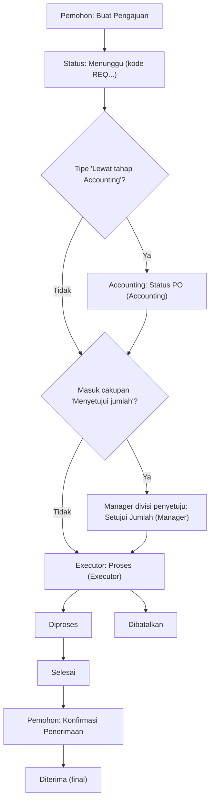
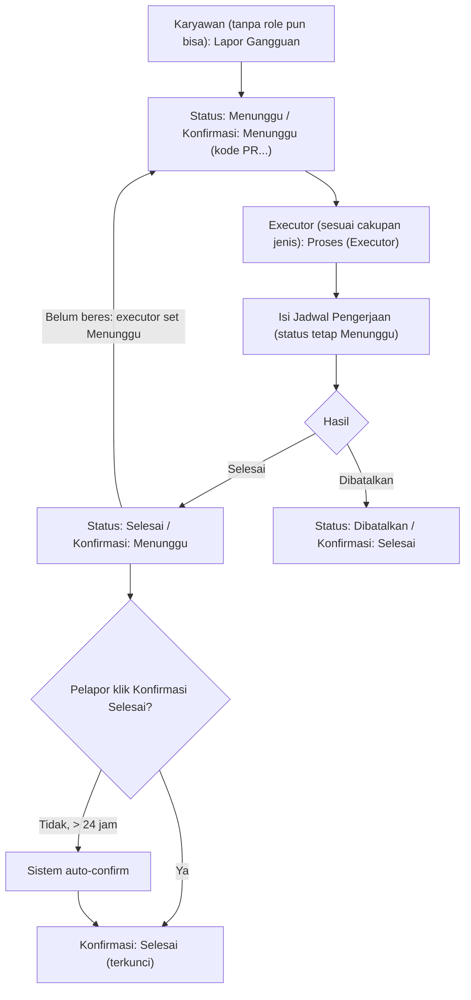
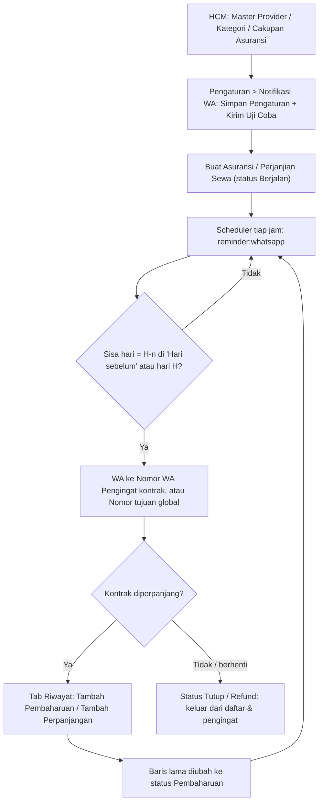
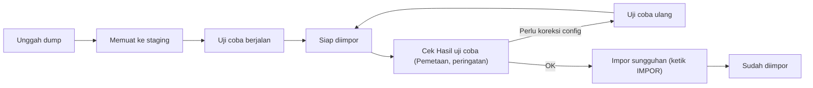

# Materi Meeting: Aplikasi Shelf Terbaru (GAIS), Fitur Shelf yang Sudah Digabung dengan Sumo

| | |
|---|---|
| **Waktu** | 13.30 WIB (perkiraan selesai 15.00) |
| **Tempat** | Aula |
| **Peserta** | Tim GA / HCM, perwakilan Accounting, Executor (GA, MIS-IT), Tim IT (Mas Apri) |
| **Agenda** | 1. Fitur baru Shelf yang sudah digabung dengan aplikasi Sumo |

**Tujuan meeting**
- Semua peserta paham bahwa **GAIS** sekarang satu aplikasi untuk aset (dari Shelf) dan layanan GA (dari Sumo), serta paham alurnya dari persiapan sampai pekerjaan selesai.
- Membagi peran dan PIC persiapan (master data, akses, server) agar setiap fitur berjalan end-to-end.
- Menguji alur utama bersama (UAT) saat meeting, lalu menyepakati keputusan dan action item untuk go-live.

---

## 1. Rundown Meeting (± 90 menit)

| Menit | Durasi | Sesi | PIC |
|---|---|---|---|
| 13.30–13.35 | 5' | Pembukaan, tujuan meeting | GA |
| 13.35–13.45 | 10' | Gambaran besar GAIS: apa yang dibawa dari Shelf dan Sumo, cara login | IT (Mas Apri) |
| 13.45–13.55 | 10' | Peran & tanggung jawab, checklist persiapan | GA + IT |
| 13.55–14.10 | 15' | Alur + demo **Pengajuan Barang** | IT / Admin Pengajuan |
| 14.10–14.20 | 10' | Alur + demo **Lapor Gangguan** | IT / Executor |
| 14.20–14.30 | 10' | Alur + demo **Asuransi & Sewa + Notifikasi WA** | HCM / IT |
| 14.30–14.40 | 10' | Fitur baru lainnya (Security, OB, Servis, Vendor, Penjualan Aset, Dasbor) | IT |
| 14.40–14.50 | 10' | Migrasi data Sumo & rencana go-live | IT |
| 14.50–15.00 | 10' | Tanya jawab, keputusan, action item | Semua |

> Catatan: UAT pada bagian 8 dicoba bareng saat demo masing-masing modul. Kalau waktunya kurang, sisanya dikerjakan setelah meeting sesuai PIC.

---

## 2. Gambaran Besar

### 2.1 Apa itu GAIS
GAIS adalah **satu panel** untuk seluruh pekerjaan General Affair:
- **Aset** (warisan aplikasi Shelf): daftar aset, BA, servis, kondisi aset, kendaraan, OB, pekerjaan vendor.
- **Layanan GA** (pindahan Sumo-web): Pengajuan Barang, Lapor Gangguan, Asuransi & Sewa, Notifikasi WA.

Sejak rilis terbaru, **semua karyawan yang punya akun bisa masuk panel**, termasuk yang belum diberi role. Tanpa role, karyawan hanya melihat **Dasbor** (kosong), **Lapor Gangguan** (laporannya sendiri), dan **Panduan**.

### 2.2 Apa yang dibawa dari Shelf dan dari Sumo

| Area | Dari Shelf (aset) | Dari Sumo (layanan GA) | Baru di GAIS |
|---|---|---|---|
| Aset | Daftar Aset, BA, Servis Aset, Kondisi Aset, Ekspor | – | Servis untuk **aset di luar daftar**, **Penjualan Aset antar Badan Usaha** + Riwayat Kepemilikan |
| Operasional | OB Checksheets, Vehicle Checksheet, Pekerjaan Vendor (Task) | – | Form OB **Mulai Pekerjaan** yang lebih ringkas, **PIC Task otomatis**, modul **Security Checksheet** |
| Pengajuan Barang | – | Pengajuan, Barang, Kategori, Satuan, Tipe Pengajuan, Periode, Log, QR | Cakupan per divisi + "Menyetujui jumlah", Rekap per Divisi, Ekspor Master QR |
| Lapor Gangguan | – | Laporan Gangguan, Jenis Gangguan, auto-confirm | Bisa diakses **semua karyawan tanpa role**, cakupan jenis gangguan per divisi, Ekspor Laporan |
| Asuransi & Sewa | – | Asuransi, Perjanjian Sewa, riwayat pembaharuan, pengingat WA | Halaman **Pengaturan > Notifikasi WA** (Kirim Uji Coba, Ganti Nomor, log) |
| Organisasi & akses | Pengguna, Role (Shield) | Area, Divisi, user Sumo | Impor JSON (Talenta), login WA OTP & Email, batas Badan Usaha, Panduan |
| Dasbor | Ringkasan aset | Ringkasan Sumo | Kartu **Perlu Tindakan** lintas modul + seksi per modul |
| Tampilan | – | – | Dropdown **Ekspor / Impor** yang seragam di semua daftar |

### 2.3 Cara Akses
- **URL:** `gais.oceanspace.co.id/admin` (halaman login `/admin/login`)
- **Tiga cara login:**

| Cara | Langkah | Catatan |
|---|---|---|
| 1. Username/Email + kata sandi | Isi "Username or Email" dan kata sandi | Akun dari Talenta **tidak punya** username/kata sandi. Admin mengisinya kalau perlu. |
| 2. WhatsApp OTP | Klik **WhatsApp** → isi **Nomor HP** → **Kirim OTP WhatsApp** → isi **Kode OTP** (6 digit) → **Verifikasi OTP** | Berlaku 5 menit. Nomor harus terdaftar sebagai "Nomor WhatsApp" di akun. |
| 3. Email (kode / magic link) | Klik **Email** → isi Email → **Kirim Kode ke Email** → isi **Kode OTP** → **Verifikasi dan Masuk**, atau klik tombol di email | Berlaku 10 menit. Email harus dimiliki tepat satu user. |

- Tidak ada **lupa kata sandi mandiri** maupun halaman profil. Kata sandi diubah oleh admin.
- Setelah login, user masuk ke **Dasbor**. Tutorial lengkap ada di menu **Panduan** (`/admin/panduan`).

---

## 3. Peran & Tanggung Jawab

| Role | Siapa (usulan) | Tugas di GAIS |
|---|---|---|
| **super_admin** | Tim IT (Mas Apri) + 1 cadangan | Memegang semua izin. Membuat role manual, memberi role, mengatur **Akses Badan Usaha**, menjalankan **Impor Data Sumo**. |
| **admin** (manual) | Admin GA senior | Impor JSON (Talenta), memberi role (hanya role yang izinnya ia miliki juga), Impersonate untuk uji tampilan. |
| **general_affair** (ADMIN Sumo) | Staf GA | Mengelola master pengajuan/gangguan/asuransi/sewa dan user/divisi. **Tidak bisa** memberi role atau impor Talenta. |
| **executor** (divisi HCM) | Staf GA/HCM | Proses pengajuan & gangguan sesuai cakupan. Akses Asuransi, Sewa, master, dan Notifikasi WA **tidak otomatis dari divisi**: executor HCM hasil Impor Sumo mendapat izinnya langsung, staf HCM baru perlu role khusus (mis. `hcm`). |
| **executor** (divisi lain, mis. MIS-IT, WHM) | Petugas pelaksana | Proses pengajuan dan laporan gangguan sesuai **Cakupan Divisi**, Setujui Jumlah (kalau divisinya penyetuju), Scan QR, ekspor. |
| **accounting** | Tim Accounting | Mengisi **Status PO (Accounting)** untuk tipe yang lewat Accounting, ekspor. |
| **requester** (USER Sumo) | Karyawan yang mengajukan barang | Membuat pengajuan, **Konfirmasi Penerimaan**, membuat laporan gangguan. |
| **Atasan** (bukan role) | Atasan langsung karyawan | Diisi di kolom **"Atasan (approver pengajuan barang)"**. Hanya bisa **melihat** pengajuan bawahan, tidak menyetujui. Atasan **tetap harus punya role** (minimal requester) supaya menu Pengajuan Barang muncul. |
| **office_boy** | OB | Mulai Pekerjaan, Foto Sebelum/Sesudah. |
| **security** | Petugas jaga | Membuat **Security Checksheet**. |
| **general_affair / audit** (manual) | Staf GA / Auditor | Operasional aset (BA, servis, kondisi, penjualan aset), Catatan Audit. |
| **Karyawan tanpa role** | Semua karyawan | Membuat Laporan Gangguan dan melihat laporannya sendiri, membuka Panduan. |
| **Sistem (scheduler)** | Server | Auto-confirm gangguan (tiap 10 menit), pengingat WA (tiap jam). |

---

## 4. Persiapan Sebelum Dipakai (Checklist Urut)

| No | Pekerjaan | Menu / Lokasi | PIC | ✓ |
|---|---|---|---|---|
| 1 | Deploy kode terbaru, `composer install --no-dev`, `php artisan migrate --force`, `php artisan permission:cache-reset` | Server | IT | ☐ |
| 2 | Isi `.env`: `WAG_URL`, `WAG_TOKEN` (login WA + pengingat), `MAIL_MAILER` (bukan log/array), `MAIL_FROM_ADDRESS` (login email) | Server `.env` | IT | ☐ |
| 3 | Redis + Horizon jalan (termasuk `supervisor-long`). Cron `* * * * * php artisan schedule:run` aktif | Server | IT | ☐ |
| 4 | Cek halaman login: tombol **WhatsApp** dan **Email** muncul di bawah "Atau masuk dengan" | `/admin/login` | IT | ☐ |
| 5 | Minimal 1 super_admin dengan **"Akses semua badan usaha"** aktif | Organisasi > Pengguna | IT | ☐ |
| 6 | Buat role manual: `general_affair`, `admin`, `audit`, lalu **centang izinnya manual** (role yang dibuat setelah deploy tidak otomatis dapat izin; untuk `admin`: ManageAccess:User, Import:User, Impersonate:User, izin user/divisi) | Pengaturan > Roles (Shield) | IT | ☐ |
| 6b | Buat role khusus untuk staf baru divisi **HCM** (izin asuransi, sewa, master, View:WaNotificationSettings, widget kontrak), **AUDIT** (Audit:ItemRequest), **MIS-IT** (ViewAll:ItemRequest). Isinya ikut `config/sumo-import.php` division_permissions | Pengaturan > Roles (Shield) | IT | ☐ |
| 7 | Master Organisasi: **Badan Usaha, Area, Divisi (dengan Area), Jabatan** | Organisasi > Badan Usaha / Area / Divisi / Jabatan | GA/HCM | ☐ |
| 8 | Master **Tipe Pengajuan** (+ toggle wajib lampiran / wajib daftar barang / Lewat tahap Accounting / Aktif) | Pengajuan Barang > Tipe Pengajuan | GA (general_affair) | ☐ |
| 9 | Master **Jenis Gangguan** | Lapor Gangguan > Jenis Gangguan | GA | ☐ |
| 10 | Master Barang: **Kategori Barang**, **Tipe Unit Barang** (Satuan), **Barang** (dengan Harga). Bisa lewat **Ekspor / Impor > Impor Excel** | Pengajuan Barang > … | GA | ☐ |
| 11 | **Periode Pengajuan** bulan berjalan | Pengajuan Barang > Periode Pengajuan | GA | ☐ |
| 12 | Impor karyawan: **Ekspor / Impor > Impor JSON (Talenta)** (file JSON, bukan Excel) | Organisasi > Pengguna | IT / admin | ☐ |
| 13 | Lengkapi tiap user: **Divisi** (wajib untuk executor), **Atasan (approver pengajuan barang)**, Nomor WhatsApp, **Roles** (bagian "Akses & Keamanan"). Simpan oleh pemegang Kelola Akses supaya nomor login WA tersimpan. Isi **Username** bila user perlu login password atau dipilih di Ubah Pemohon | Organisasi > Pengguna > Edit | GA isi Divisi/Atasan, IT/admin isi Roles | ☐ |
| 14 | **Cakupan Pengajuan Barang** per divisi executor (Tipe, Area pemohon, toggle **Menyetujui jumlah**). Tanpa baris cakupan, executor **tidak melihat pengajuan apa pun**. Di lingkungan tanpa Impor Sumo, cakupan WHM/MKLI-HO/AUDIT harus dibuat manual | Organisasi > Divisi > Edit | GA | ☐ |
| 15 | **Cakupan Laporan Gangguan** per divisi executor (Jenis gangguan, toggle **Kecualikan**). Kebalikan dari pengajuan: divisi **tanpa** baris cakupan melihat **semua** laporan | Organisasi > Divisi > Edit | GA | ☐ |
| 16 | **Akses Badan Usaha**: nyalakan "Akses semua badan usaha" atau centang BU untuk setiap executor, accounting, dan HCM yang melayani lintas BU. User baru (Talenta/manual) hanya melihat BU asalnya | Organisasi > Pengguna > Edit > Akses Badan Usaha | IT (super_admin) | ☐ |
| 17 | Master Asuransi: **Provider Asuransi, Kategori Asuransi, Cakupan Asuransi** | Asuransi & Sewa > … | HCM | ☐ |
| 18 | **Notifikasi WA**: aktifkan, **Nomor tujuan global (wajib; default kosong, cutoff selalu ke nomor ini, kontrak tanpa Nomor WA Pengingat dilewati)**, Jam kirim (jam bulat, mis. 08:00), Hari sebelum, lalu **Kirim Uji Coba** | Pengaturan > Notifikasi WA | HCM + IT | ☐ |
| 19 | Beri role `security` / `office_boy` ke petugas. Master Pekerjaan OB / Shift OB (opsional) | Pengguna; OB / Kebersihan | GA | ☐ |
| 20 | Upload besar (video security 50 MB): naikkan `upload_max_filesize`, `post_max_size`, `client_max_body_size` | Server PHP/Nginx | IT | ☐ |

> **Penting:** Impor Talenta **tidak** mengisi Divisi, Atasan, Role, Username, dan Kata Sandi. Tanpa Role, karyawan hanya bisa Lapor Gangguan.
>
> **Accounting** hanya melihat pengajuan bertipe "Lewat tahap Accounting". Pastikan minimal satu Tipe Pengajuan aktif memakai toggle itu (ASSET/NONASSET di data Sumo).

---

## 5. Alur End-to-End per Modul

### 5.1 Pengajuan Barang



**Langkah demi langkah**

| No | Aktor | Menu / Tombol | Yang dilakukan | Status hasil | Notifikasi |
|---|---|---|---|---|---|
| 1 | Pemohon (role requester) | Pengajuan Barang > **Buat Pengajuan** | Pilih **Tipe Pengajuan**. Kalau tipe wajib lampiran, unggah **File Persetujuan Atasan** (JPG/PNG/PDF ≤ 5 MB). Kalau wajib daftar barang, isi **Barang yang diajukan** (Barang, Jumlah ≥ 0,01, Keterangan; **Tambah barang**). Klik **Buat**. | **Menunggu** (kode REQ{id}) | Tidak ada WA. Badge menu bertambah. |
| 2 | Pemohon | Detail > tabel **Barang yang Diajukan** | Tambah/ubah/hapus barang selama status Menunggu (⚠️ masih bisa walau Manager sudah Setujui Jumlah, selama executor belum memproses) | Menunggu | – |
| 3 | Accounting | Aksi **Status PO (Accounting)** | Nyalakan **PO sudah diterbitkan**, isi **Nomor PO**, Kirim | Tetap Menunggu, Riwayat Approval Accounting ✓ | – |
| 4 | Manager (anggota divisi penyetuju; kalau tidak ada cakupan "Menyetujui jumlah" yang cocok, semua pemegang izin approve_manager bisa dan tahap ini opsional) | **Barang yang Diajukan** > Ubah (**Jumlah Disetujui**) → **Setujui Jumlah (Manager)** | Barang yang tidak diubah otomatis disetujui sama dengan jumlah diminta | Tetap Menunggu, Manager ✓ | – |
| 5 | Executor | Filter **Belum diproses executor** / kartu **Pengajuan Menunggu Executor** → **Proses (Executor)** | Pilih keputusan: **Diproses**, **Selesai**, **Dibatalkan**, atau **Menunggu (kembalikan ke antrean)**, lalu isi Catatan | Diproses → Selesai | Muncul di **Pengajuan Menunggu Konfirmasi** |
| 6 | Pemohon | Detail → **Konfirmasi Penerimaan** | Pilih **Diterima** (atau **Masih menunggu** yang hanya menyimpan catatan) | **Diterima** (final) | – |
| Opsional | Pemohon / admin | **Batalkan** (Alasan opsional) | – | Dibatalkan | Tercatat di Log Pengajuan |
| Opsional | Executor | **Ubah Pemohon** (hanya ke user yang punya Username), **Catatan Audit**, **Cetak QR**, menu **Scan QR Pengajuan** / **Scan QR Barang** | – | – | – |
| Laporan | Accounting / Executor / Admin | **Rekap per Divisi**, **Ekspor Master QR**, bulk **Ekspor Excel** | – | – | – |

**Aturan penting**
- **Kuota:** maksimal **2 pengajuan terbuka per tipe per pemohon**. Status terbuka = Menunggu, Diproses, dan Selesai yang belum dikonfirmasi. Tipe yang kuotanya penuh **tidak muncul** di pilihan.
- Tahap **Accounting** (hanya tipe tertentu) dan **Manager** (wajib hanya kalau ada cakupan "Menyetujui jumlah" yang cocok) **boleh dikerjakan urutan bebas**, tetapi keduanya harus selesai sebelum tombol **Proses (Executor)** muncul. Setelah itu **Executor**, lalu **Pemohon**.
- **Atasan hanya melihat**, tidak menyetujui di aplikasi. Persetujuan atasan diwakili file yang diunggah pemohon.
- **Konfirmasi Penerimaan hanya oleh pemohon sendiri**. Admin pun tidak bisa mewakili.
- **Periode Pengajuan tidak memblokir** pembuatan pengajuan. Fungsinya hanya info widget dan pengingat WA cutoff.
- **Tidak ada WA/email per tahap.** Petugas wajib memantau badge menu dan kartu Perlu Tindakan.
- Total biaya = Jumlah Disetujui (atau diminta) × Harga barang. Kalau harga kosong, total Rp 0.
- Stok barang **tidak** berkurang otomatis. Pengajuan barang tidak punya auto-confirm.
- ⚠️ Accounting yang menyimpan modal PO dengan toggle mati tetap dianggap lolos. Accounting **hanya klik Kirim kalau PO benar-benar terbit**.
- ⚠️ Aksi Proses masih muncul untuk status Dibatalkan. Executor harus cek status dulu sebelum memproses.

**Otomatisasi:** kode REQ{id} dibuat otomatis; jumlah disetujui otomatis diisi saat Setujui Jumlah; pengingat WA **"PENGINGAT BATAS AKHIR PENGAJUAN BARANG"** dikirim ke Nomor tujuan global pada H-3, H-1, dan hari H Tanggal Tutup periode (default).

---

### 5.2 Lapor Gangguan



| No | Aktor | Menu / Tombol | Yang dilakukan | Status hasil | Notifikasi |
|---|---|---|---|---|---|
| 1 | Admin | Lapor Gangguan > **Jenis Gangguan** | Isi master (Nama) | – | – |
| 2 | Admin | Divisi > Edit > **Cakupan Laporan Gangguan** > **Tambah cakupan** | Pilih **Jenis gangguan**, toggle **Kecualikan** bila perlu | – | – |
| 3 | Pelapor | Lapor Gangguan > Laporan Gangguan > **Lapor Gangguan** | Isi **Jenis Gangguan** (wajib), **Judul (opsional)**, **Keterangan Gangguan** (wajib), **Foto Gangguan / Kerusakan** (wajib, gambar ≤ 5 MB) | **Menunggu** / Konfirmasi **Menunggu**, kode PR{id} | Toast saja |
| 3b | Executor (opsional) | **Lapor Gangguan** + field **Pelapor** | Melapor atas nama karyawan lain | Menunggu | – |
| 4 | Executor | Badge menu, tab **Menunggu**, kartu **Gangguan Terbuka**, tabel **Laporan Gangguan Belum Ditutup** | Memantau laporan masuk | – | Badge/widget saja |
| 5 | Executor | **Proses (Executor)** | Status tetap Menunggu, isi **Jadwal Pengerjaan** | Menunggu (terjadwal) | Toast "Laporan diperbarui." |
| 6 | Executor | **Proses (Executor)** | Status **Selesai**, **Foto Hasil** (opsional ≤ 5 MB), **Hasil Pengerjaan** | **Selesai** / Konfirmasi Menunggu, "Ditutup Oleh" tercatat | Pelapor **tidak** mendapat WA/email |
| 6b | Executor | **Proses (Executor)** | Status **Dibatalkan** + alasan di Hasil Pengerjaan | Dibatalkan / Konfirmasi **Selesai** | – |
| 7 | Pelapor | Detail → **Konfirmasi Selesai** + **Ulasan (opsional)** | Cek foto Sebelum/Sesudah | Konfirmasi **Selesai** | Toast "Terima kasih, laporan ditandai selesai." |
| 8 | Sistem | – | Auto-confirm laporan yang ditutup lebih dari 24 jam (cek tiap 10 menit) | Konfirmasi Selesai | – |
| 9 | Executor / Admin | **Ekspor Laporan** (Dari/Sampai tanggal → **Unduh**) | File `laporan-gangguan-YYYYMMDD-YYYYMMDD.xlsx` | – | – |

**Aturan penting**
- Status hanya **Menunggu, Selesai, Dibatalkan**. Tidak ada status "Diproses". Laporan yang sedang dikerjakan ditandai dengan **Jadwal Pengerjaan**.
- **Satu pelapor hanya boleh punya satu laporan yang Konfirmasi-nya masih Menunggu.** Laporan kedua ditolak dengan pesan "Harap menunggu hingga laporan sebelumnya diproses dan status akhirnya diselesaikan."
- Pelapor **tidak punya tombol tolak**. Kalau belum beres, jangan konfirmasi dan langsung hubungi executor sebelum 24 jam lewat. Executor bisa mengembalikan status ke **Menunggu**.
- Setelah dikonfirmasi (manual atau otomatis), laporan **terkunci**.
- Visibilitas: pelapor hanya melihat laporannya sendiri. Executor melihat sesuai **cakupan jenis divisinya** dan badan usaha. **Executor yang divisinya tidak punya cakupan (atau tidak punya divisi) melihat semua laporan.** Divisi yang dibatasi tidak melihat laporan tanpa jenis.
- Laporan **Dibatalkan** langsung terkunci dan tidak bisa dibuka lagi; pelapor membuat laporan baru.
- **Tidak ada notifikasi WA/email** di modul ini. SOP: executor memantau badge/Dasbor beberapa kali sehari.
- Hanya admin yang bisa menghapus laporan (masuk Sampah).

**Otomatisasi:** kode PR{id}; badan usaha disalin dari pelapor; auto-confirm tiap 10 menit (paling lambat ± 24 jam 10 menit); Dibatalkan otomatis menjadi Konfirmasi Selesai.

---

### 5.3 Asuransi & Sewa + Notifikasi WA



| No | Aktor | Menu / Tombol | Yang dilakukan | Status hasil | Notifikasi |
|---|---|---|---|---|---|
| 1 | HCM | Asuransi & Sewa > **Provider Asuransi / Kategori Asuransi / Cakupan Asuransi** | Isi Nama (unik) | – | – |
| 2 | HCM | Pengaturan > **Notifikasi WA** | **Aktifkan pengingat WhatsApp**, **Nomor tujuan global** (pisah koma), **Jam kirim** (jam bulat), toggle **Jatuh tempo sewa / Jatuh tempo asuransi / Cutoff pengajuan barang**, **Hari sebelum** (mis. 30,14,7,1) → **Simpan Pengaturan** | – | Toast "Pengaturan notifikasi disimpan." |
| 3 | HCM | **Kirim Uji Coba** → isi Nomor WhatsApp | Uji koneksi WagHub | Log "Uji Kirim" | WA uji coba |
| 4 | HCM | Asuransi & Sewa > **Asuransi** > Buat | Wajib: Nomor Polis, Nama Tertanggung, Kategori, Cakupan, Tanggal Mulai, Tanggal Berakhir. Opsional: nilai/premi stok & bangunan, **Nomor WA Pengingat**, dll. | **Berjalan** | – |
| 5 | HCM | Asuransi & Sewa > **Perjanjian Sewa** > Buat | Kode Sewa boleh kosong (otomatis RENT0001…). Wajib: Objek Sewa, Alamat, Pihak Pertama/Kedua, tanggal, Status, Sewa per Tahun. Isi Dana PKP/NON-PKP, Pengingat (bulan sebelum), file (jpeg/png/pdf ≤ 10 MB) | **Berjalan** | – |
| 6 | HCM | Daftar (filter **Masih berjalan**, **Jatuh tempo ≤ 30 hari** / **Berakhir ≤ 30 hari**) | Memantau warna jatuh tempo, Status Stok, Status Tagihan | – | – |
| 7 | Sistem | – | Tiap jam, setelah Jam kirim: kirim pengingat kalau sisa hari ada di daftar "Hari sebelum" atau hari H | – | WA **"PENGINGAT JATUH TEMPO SEWA"** / **"PENGINGAT JATUH TEMPO ASURANSI"** |
| 8 | HCM | Detail polis > tab **Riwayat Pembaharuan** > **Tambah Pembaharuan** | Isi nomor polis baru dan tanggal baru | Baris baru **Berjalan**, daftar mengikuti baris terbaru | – |
| 9 | HCM | Edit baris periode lama | Ubah ke **Pembaharuan** supaya premi lama tidak dihitung dobel | Pembaharuan | – |
| 10 | HCM | Detail sewa > tab **Riwayat Perpanjangan** > **Tambah Perpanjangan** | Kode otomatis RENTUP0001… | Berjalan | – |
| 11 | HCM | Edit kontrak/riwayat | Status **Tutup** atau **Refund** untuk mengakhiri | Keluar dari daftar default dan pengingat | – |
| 12 | HCM | **Ekspor / Impor > Impor Excel** / **Ekspor Semua Asuransi / Sewa**; tab Riwayat: **Impor/Ekspor Pembaharuan / Perpanjangan** | Impor/ekspor massal | – | – |
| 13 | HCM | Notifikasi WA > **Ganti Nomor** | Ganti nomor PIC di semua kontrak sekaligus | "Nomor diperbarui pada X sewa dan Y asuransi." | – |

**Aturan penting**
- Pengingat dikirim **hanya pada hari yang persis ada di "Hari sebelum"** dan pada **hari H**. Kontrak yang sudah lewat jatuh tempo tidak diingatkan lagi.
- **WA sewa mengikuti "Hari sebelum (sewa)"**, bukan "Pengingat (bulan sebelum)". Bulan sebelum hanya mengatur warna di daftar.
- Tujuan WA: **Nomor WA Pengingat** kontrak. Kalau kosong, ke **Nomor tujuan global**. Cutoff pengajuan selalu ke nomor global.
- Anti-dobel: satu nomor menerima maksimal 1 pesan sukses per kontrak per hari. Kiriman gagal dicoba ulang jam berikutnya.
- **Jam kirim harus jam bulat** (08:00). Jam 08:30 baru terkirim jam 09:00, dan jam di atas 23:00 tidak pernah terkirim.
- **Perpanjangan wajib dicatat sebagai baris riwayat baru**, bukan dengan mengedit induk.
- Satu baris riwayat berstatus **Tutup/Refund** menghentikan seluruh kontrak.
- Warna asuransi: kuning 15–30 hari, merah ≤ 14 hari. Status Stok: **Overlimit/Underlimit** kalau selisih ≥ 30%. Status Tagihan sewa: **LUNAS / LEBIH / BELUM LUNAS**.
- Akses modul: super_admin, general_affair, dan user yang **diberi izin** asuransi/sewa (executor HCM hasil Impor Sumo, atau role `hcm` baru). Tidak ada akses otomatis berdasarkan divisi.

**Otomatisasi:** `reminder:whatsapp` tiap jam; kode RENT/RENTUP otomatis; "Diinput Oleh" otomatis; isian pembaharuan terisi dari induk; warna, Status Stok, dan Status Tagihan dihitung otomatis.

---

## 6. Fitur Baru Lainnya

| Fitur | Siapa | Alur singkat | Aturan penting |
|---|---|---|---|
| **Security Checksheet** | role `security`; atasan dengan izin view_all | Security > Security Checksheet > Buat ("Buat Laporan Security"). Isi **Lokasi Kerja** (otomatis dari laporan terakhir), 11 butir checklist (Keamanan, Kelistrikan, Kondisi Aset, Kebersihan), **Kondisi Darurat / Temuan Kejadian**, **Lampiran Foto / Video** → **Kirim Laporan** | Nomor SEC-YYYYMMDD-0001. Badge **Aman** / **Ada Temuan**. Maks 10 file, 50 MB/file. Draf tersimpan 12 jam (lampiran tidak ikut). Petugas tidak bisa edit/hapus selama role security hanya memegang view_any/view/create (cek di Shield setelah migrate, karena migrasi menyalin izin OB yang ada). Atasan bisa filter "Ada temuan kejadian" dan Ekspor Excel. |
| **Pekerjaan OB** | `office_boy`; pemberi tugas (assign) | Buat ("Mulai Pekerjaan"): **Nama Pekerjaan** + **Foto Sebelum** → **Mulai** → **Foto Sesudah** → **Simpan & Selesaikan**. Pemberi tugas: **Tugaskan per Shift** / **Tambah Tugas** (kosongkan Petugas OB untuk kolam bersama) | Status: Belum Dikerjakan → Sedang Dikerjakan → Selesai. Ada **Mulai Semua & Foto Sebelum** (submit **Simpan & Mulai**) dan **Selesaikan Semua & Foto Sesudah**. Menu master sekarang bernama **Pekerjaan OB**. |
| **Servis Aset di luar daftar** | Staf GA / teknisi | Aset > Servis Aset > Buat → "Aset yang diservis ada di daftar aset?" pilih **Tidak, aset di luar daftar** → Nama Aset, No. Seri → **Selesaikan** → **Simpan & Selesaikan** | Nomor SRV-YYYYMM-xxxx. Aset luar **tidak** masuk daftar aset. Untuk aset milik perusahaan, sebaiknya didaftarkan dulu. |
| **PIC Pekerjaan Vendor otomatis** | Pembuat Task | Pekerjaan Vendor > Task > Buat. PIC otomatis = pembuat. Lalu Process → Complete → Download PDF → Upload | Kolom PIC dan Tanggal Dibuat tampil di tabel. PIC tidak bisa diganti, jadi Task harus dibuat oleh penanggung jawabnya. |
| **Penjualan Aset antar Badan Usaha** | Staf GA (Create:AssetSale) | Detail aset → **Jual ke Badan Usaha Lain** → Badan Usaha Pembeli, Tanggal, Harga Jual, Dokumen (BAST/Invoice ≤ 4 MB) → **Catat Penjualan**. Atau Aset > Penjualan Aset > **Catat Penjualan** / **Impor Excel** | Aset harus Tersedia dan tanpa pemegang. Pemilik pindah ke pembeli, muncul **Riwayat Kepemilikan**. Menghapus riwayat **tidak** mengembalikan kepemilikan. Impor: 1 baris salah membatalkan seluruh file. "Tandai Dijual" tetap dipakai untuk aset yang keluar dari grup. |
| **Dropdown Ekspor / Impor** | Semua sesuai izin | Satu dropdown **Ekspor / Impor** di Aset, Penjualan Aset, Pengguna, Asuransi, Sewa, Barang, Vehicle Checksheet | Ekspor Filament diproses di antrean (Horizon harus jalan). |
| **Dasbor** | Semua (sesuai izin widget) | Kartu **Perlu Tindakan** (klik untuk membuka daftar terfilter) + seksi lipat per modul: Aset, Pengajuan Barang, Lapor Gangguan, Asuransi & Sewa, Operasional, Organisasi & Data Master | Kartu 0 berwarna abu-abu ("tidak ada antrean"). User tanpa role, `security`, dan `office_boy` tidak mendapat widget. |

> Semua fitur baru ini **tidak mengirim WA/email**. Pemberitahuan hanya berupa toast di layar.

---

## 7. Migrasi Data Sumo & Rencana Go-Live

### 7.1 Alur migrasi (menu **Pengaturan > Impor Data Sumo**, `/admin/impor-sumo`)



- Uji coba **tidak mengubah** data GAIS (rollback). Impor sungguhan berjalan dalam satu transaksi: kalau gagal, tidak ada yang tersimpan.
- Impor bisa diulang tanpa menggandakan data, tetapi **hanya menambah baris baru**. Perubahan status di Sumo setelah impor pertama **tidak** ikut diperbarui. Karena itu impor final harus dilakukan **setelah freeze**.
- User Sumo login memakai **username & password Sumo lama**, kecuali akunnya digabung ke akun GAIS yang sudah punya login.
- Role Sumo dipetakan: ADMIN → general_affair, ACCOUNTING → accounting, EXECUTOR → executor, USER → requester.
- Cakupan divisi hasil Sumo (hanya diisi pada impor pertama): WHM, MKLI-HO, AUDIT bertanda **Menyetujui jumlah**; gangguan HCM hanya UMUM, MIS-IT selain UMUM.
- Kode lama (REQ123) dan **label QR lama tetap berlaku**.

### 7.2 Cutover Checklist

| Tahap | Pekerjaan | PIC | ✓ |
|---|---|---|---|
| H-7 s/d H-1 | Deploy final, migrate, `horizon:terminate`, cron aktif | IT | ☐ |
| H-7 s/d H-1 | Rehearsal di staging: unggah dump, uji coba, perbaiki `business_entities` (cek CV.CS, PT. RISM) dan `user_links`, jalankan UAT | IT + GA | ☐ |
| H-7 s/d H-1 | GA verifikasi peringatan penggabungan user dan pemetaan badan usaha (tidak ada "(TIDAK ADA)") | GA/HCM | ☐ |
| Hari H, langkah 1 | Umumkan freeze, set Sumo-web read-only/maintenance, **matikan cron Sumo-web** (supaya WA tidak dobel) | IT | ☐ |
| Hari H, langkah 2 | `mysqldump db_sumo \| gzip`, simpan salinan storage Sumo | IT | ☐ |
| Hari H, langkah 3 | Backup `db_gais` + bucket | IT | ☐ |
| Hari H, langkah 4 | Unggah dump → cek uji coba → **Impor sungguhan** (ketik IMPOR) | IT (super_admin) | ☐ |
| Hari H, langkah 5 | Salin folder **Request_File, Problem_Report_File, Rent_File, product** ke bucket S3 `gais` | IT | ☐ |
| Hari H, langkah 6 | Notifikasi WA: cek nomor global/jam kirim → **Kirim Uji Coba**. Cek scheduler | HCM + IT | ☐ |
| Hari H, langkah 7 | Smoke test login per role + data sampel (5 pengajuan lama) | GA + IT | ☐ |
| Hari H, langkah 8 | Buka GAIS untuk semua user, umumkan URL dan cara login | GA | ☐ |
| H+1 s/d H+14 | Pantau Horizon failed_jobs, WA reminder, auto-confirm. Sumo-web read-only sebagai rujukan, lalu dimatikan dan diarsipkan | IT | ☐ |
| Rollback | Restore backup `db_gais`, nyalakan kembali Sumo-web | IT | – |

> ⚠️ **Jangan pernah** me-restore dump Sumo langsung ke `db_gais`. Muat hanya lewat panel atau `sumo:import --file`.

---

## 8. Skenario Uji End-to-End (UAT) Saat Meeting

**Data uji:** A = karyawan requester (divisi berarea TOP, Atasan = B), B = atasan, C = accounting, D = executor (divisi dengan cakupan ATK + Area TOP + Menyetujui jumlah), E = executor HCM (cakupan gangguan UMUM), F = executor MIS-IT (UMUM + Kecualikan), G = karyawan tanpa role, S = security.

| No | Skenario | Aktor | Langkah | Hasil yang diharapkan | ✓ |
|---|---|---|---|---|---|
| 1 | Tombol login | IT | Buka `/admin/login` | Tombol **WhatsApp** dan **Email** tampil di bawah "Atau masuk dengan" | ☐ |
| 2 | Impor Talenta | super_admin | Organisasi > Pengguna > **Impor JSON (Talenta)**, unggah 2 karyawan uji | "Import Talenta selesai. Berhasil: 2 karyawan." Field Name/Email/Nomor WhatsApp terkunci ("Mengikuti Talenta…") | ☐ |
| 3 | Login tanpa role (WA OTP) | G | **WhatsApp** → Nomor HP → **Kirim OTP WhatsApp** → kode → **Verifikasi OTP** | Masuk Dasbor kosong tanpa kartu Perlu Tindakan. Menu hanya Dasbor, Lapor Gangguan, dan Panduan | ☐ |
| 4 | Login Email | B | **Email** → **Kirim Kode ke Email** → klik magic link | Masuk Dasbor. Kode di email yang sama sudah tidak berlaku | ☐ |
| 5 | Lengkapi user | super_admin | Isi Divisi, Atasan = B, Roles = requester untuk A **dan B** | Setelah login ulang, A melihat menu Pengajuan Barang dan Perlu Tindakan | ☐ |
| 6 | Buat pengajuan | A | **Buat Pengajuan** ATK, 2 barang | Kode REQxxx, **Menunggu**, kolom Tahap ⏳ Manager | ☐ |
| 7 | Kuota | A | Buat pengajuan ATK ke-2, lalu coba ke-3 | Tipe ATK tidak muncul di pilihan | ☐ |
| 8 | Atasan melihat | B | Buka Pengajuan Barang | Melihat pengajuan A, tanpa tombol setujui | ☐ |
| 9 | Executor belum bisa | D | Buka pengajuan sebelum Manager | Tombol **Proses (Executor)** tidak tampil | ☐ |
| 10 | Setujui jumlah | D (anggota divisi penyetuju) | Ubah **Jumlah Disetujui** 1 barang → **Setujui Jumlah (Manager)** | Manager ✓, barang lain = diminta, Total dihitung ulang | ☐ |
| 11 | Tahap Accounting | A lalu C | A membuat pengajuan **ASSET/NONASSET** (tipe "Lewat Accounting", wajib File Persetujuan Atasan). C → **Status PO (Accounting)** + Nomor PO. Diproses executor yang cakupannya meliputi ASSET (atau tambah ASSET ke cakupan D) | Accounting ✓, Nomor PO tampil, tombol Proses muncul untuk executor ber-cakupan | ☐ |
| 12 | Proses | D | **Proses (Executor)** → Diproses, lalu Selesai | Status **Selesai**, "Ditutup Oleh" = D | ☐ |
| 13 | Konfirmasi | A | **Konfirmasi Penerimaan** → Diterima | Status **Diterima**, kuota ATK A kembali | ☐ |
| 13b | Kembalikan ke antrean | D | Pengajuan ke-2: **Proses (Executor)** → Selesai, lalu **Menunggu (kembalikan ke antrean)** | Approval Executor di-reset, tombol Konfirmasi hilang dari A | ☐ |
| 14 | QR | D | **Cetak QR** → **Scan QR Pengajuan** | Detail benar, tombol **Buka pengajuan** berfungsi | ☐ |
| 15 | Lapor gangguan | G | **Lapor Gangguan** jenis UMUM + foto | PR{id}, Menunggu / Konfirmasi Menunggu | ☐ |
| 16 | Satu laporan terbuka | G | Coba lapor lagi | Ditolak "Harap menunggu hingga laporan sebelumnya diproses…" | ☐ |
| 17 | Cakupan gangguan | E, F | Login masing-masing | E melihat laporan UMUM, F tidak melihatnya | ☐ |
| 18 | Proses gangguan | E | **Proses (Executor)**: Jadwal, lalu Selesai + Foto Hasil | Selesai / Konfirmasi Menunggu | ☐ |
| 18b | Kembalikan gangguan | E | Laporan uji lain: Selesai → **Proses (Executor)** → Menunggu sebelum dikonfirmasi | Kembali Menunggu, pelapor belum bisa konfirmasi | ☐ |
| 19 | Konfirmasi gangguan | G | **Konfirmasi Selesai** + ulasan | Konfirmasi Selesai, laporan terkunci, G bisa lapor lagi | ☐ |
| 20 | Auto-confirm | IT | Staging: set closed_at > 24 jam → `php artisan problem-reports:auto-confirm` | "1 laporan ditandai selesai." | ☐ |
| 21 | WA uji | HCM | Notifikasi WA → **Kirim Uji Coba** | WA diterima, log "Uji Kirim" success | ☐ |
| 22 | Polis H-7 | HCM | Buat polis Tanggal Berakhir = hari ini + 7 | Jatuh Tempo merah, masuk kartu **Polis Jatuh Tempo ≤ 30 Hari** | ☐ |
| 23 | Sewa | HCM | Buat sewa **1 tahun (≤ 366 hari)** tanpa kode, Dana PKP = Sewa per Tahun | Kode RENT#### otomatis, **LUNAS** | ☐ |
| 24 | Pengingat WA | IT | `php artisan reminder:whatsapp --dry-run`, lalu `--force` | Dry-run menampilkan [UJI]; --force mengirim WA "PENGINGAT JATUH TEMPO …" "7 Hari Lagi". Jalankan ulang → dilewati (anti-dobel) | ☐ |
| 25 | Pembaharuan | HCM | Tab **Riwayat Pembaharuan** → **Tambah Pembaharuan** + 1 tahun | Nomor baru + "Awal: …", tidak lagi masuk dry-run H-7 | ☐ |
| 26 | Tutup kontrak | HCM | Baris riwayat sewa → **Tutup** | Hilang dari "Masih berjalan", dari kartu dasbor, dan dari dry-run | ☐ |
| 27 | Security | S | Buat laporan, isi 11 butir, 2 foto + 1 video, **Kirim Laporan** | "Laporan security terkirim.", badge Aman, SEC-YYYYMMDD-0001 | ☐ |
| 28 | Servis aset luar | GA | Servis Aset → "Tidak, aset di luar daftar" → **Selesaikan** | Status Selesai, aset tidak muncul di menu Aset | ☐ |
| 29 | Jual antar BU | GA | Aset Tersedia PT A → **Jual ke Badan Usaha Lain** → PT B | Pemilik = PT B, Riwayat Kepemilikan 1 baris | ☐ |
| 30 | Dasbor | super_admin, executor, requester | Klik kartu **Perlu Tindakan** | Daftar terbuka dengan filter yang sesuai, angka sesuai hak lihat | ☐ |

---

## 9. Masalah Umum & Solusi (FAQ)

| Masalah | Penyebab / Solusi |
|---|---|
| Karyawan hanya melihat Dasbor kosong, Lapor Gangguan & Panduan | Normal untuk user tanpa role. Beri role (requester, security, office_boy, dst.). |
| Karyawan Talenta tidak bisa login pakai password | Impor Talenta tidak membuat username/password. Pakai login WhatsApp atau Email, atau admin mengisi Username/Password. |
| Login WA: "Nomor belum terdaftar untuk login…" | Nomor login baru tersimpan kalau form disimpan oleh pemegang Kelola Akses atau berasal dari Talenta. Minta super_admin/admin buka Edit Pengguna lalu **Simpan** ulang. Pastikan nomor tidak dipakai user lain. |
| Tombol WhatsApp/Email tidak muncul | IT isi `WAG_URL`/`WAG_TOKEN`, `MAIL_MAILER` (bukan log/array), `MAIL_FROM_ADDRESS`, lalu `php artisan optimize:clear`. |
| Kode email tidak datang | Email dipakai lebih dari satu user. Rapikan duplikat, lalu cek log SMTP. |
| Terlalu banyak salah OTP | **WA:** kirim maksimal 3 kali per 2 menit per nomor; 5 kali salah → ulang proses. **Email:** kirim maksimal 3 kali per 5 menit (10 per jam); kode hangus setelah 5 kali salah. |
| Lupa kata sandi | Tidak ada reset mandiri. Admin mengubahnya di Edit Pengguna. |
| general_affair tidak melihat field Roles | Bagian "Akses & Keamanan" hanya untuk super_admin/admin. |
| Tipe pengajuan tidak muncul | Kuota 2 pengajuan terbuka penuh (biasanya ada yang Selesai belum dikonfirmasi) atau tipe tidak Aktif. |
| Executor tidak melihat pengajuan | Cek: user punya Divisi, role punya izin proses, Divisi punya **Cakupan Pengajuan** yang cocok, Divisi pemohon punya Area, badan usaha masuk akses. |
| Tombol **Proses (Executor)** tidak muncul | Masih menunggu Accounting (Status PO) atau **Setujui Jumlah (Manager)** dari divisi penyetuju. |
| Atasan tidak bisa menyetujui | Sesuai desain. Atasan hanya melihat. |
| Atasan tidak melihat menu Pengajuan Barang | Atasan belum punya role. Beri minimal role requester. |
| Staf HCM baru tidak melihat Asuransi & Sewa / Notifikasi WA | Izin tidak ikut divisi. Beri role khusus HCM. |
| Executor/Accounting tidak melihat pengajuan BU lain | Nyalakan "Akses semua badan usaha" atau centang BU di Edit Pengguna. |
| Pengingat kontrak "dilewati" | Kontrak tanpa Nomor WA Pengingat dan Nomor tujuan global kosong. Isi nomor global. |
| Mengisi "Alur Persetujuan (Approval Flow)" di Divisi tidak berpengaruh | Field ini tidak dipakai alur. Yang berpengaruh: Atasan, Cakupan + Menyetujui jumlah, dan role. |
| Total biaya Rp 0 | Harga barang kosong. Isi Harga di menu Barang. |
| Tidak ada yang tahu ada pengajuan/laporan baru | Tidak ada WA per tahap. Pantau badge menu dan **Perlu Tindakan**. |
| Pelapor tidak bisa lapor lagi | Masih ada laporan dengan Konfirmasi Menunggu. Pelapor klik **Konfirmasi Selesai**, atau executor set Dibatalkan. |
| Laporan tidak pernah auto-confirm | Cron `schedule:run` belum jalan. |
| Foto tidak tampil | `php artisan storage:link` / cek S3. File lama Sumo harus disalin ke bucket. |
| Pengingat WA tidak terkirim | Cek saklar aktif + toggle per jenis, nomor tujuan, angka "Hari sebelum", Jam kirim sudah lewat, cron jalan, **Kirim Uji Coba** berhasil. IT: `reminder:whatsapp --dry-run`. |
| Pengingat tidak datang padahal tinggal 10 hari | Hanya dikirim pada angka yang ada di "Hari sebelum". Tambahkan angka 10. |
| Kontrak sudah diperpanjang tapi tetap merah | Catat perpanjangan sebagai baris baru di tab Riwayat. |
| Kontrak hilang dari daftar | Ada baris riwayat Tutup/Refund. Matikan filter "Masih berjalan" untuk menemukannya. |
| Master asuransi dobel setelah impor | Impor kontrak otomatis membuat master dari nama yang salah ketik. Samakan ejaan. |
| Menu Security tidak muncul | Beri role `security`, lalu `permission:cache-reset`. |
| Video security gagal diunggah | Naikkan batas upload PHP/Nginx ke ≥ 50 MB. |
| Tombol **Jual ke Badan Usaha Lain** tidak muncul | Aset harus Tersedia tanpa pemegang (buat BA Pengembalian dulu) dan user harus punya izin Create:AssetSale. |
| File ekspor tidak kunjung siap | Horizon harus berjalan. |
| Dasbor kosong | User belum punya izin widget (`View:{NamaWidget}`) untuk modul itu. |

---

## 10. Catatan Teknis untuk Tim IT

**ENV wajib**
- `WAG_URL`, `WAG_TOKEN` (login WA + semua pengingat WA), `WHATSAPP_OTP_TTL_MINUTES` (default 5)
- `MAIL_MAILER` (bukan log/array), `MAIL_FROM_ADDRESS`, `EMAIL_LOGIN_EXPIRES_IN` (default 600 detik)
- `QUEUE_CONNECTION=redis`, `ITEM_REQUEST_MAX_OPEN_PER_TYPE` (default 2)
- `SUMO_DB_PREFIX` (default `sumo_dump_`; jangan `sumo_` atau kosong), `SUMO_IMPORT_DISK`, `SUMO_IMPORT_MAX_UPLOAD_KB` (12288)
- S3 production: `FILESYSTEM_DISK=s3`, `PUBLIC_FILESYSTEM_DRIVER=s3`, `AWS_BUCKET=gais`, `AWS_USE_PATH_STYLE_ENDPOINT=true`

**Server**
- Cron: `* * * * * php artisan schedule:run`
- Redis (cache + session dipakai bersama), Horizon + `supervisor-long` (redis-long, timeout 3600, memory 512 MB)
- PHP/Nginx: `upload_max_filesize`, `post_max_size`, `client_max_body_size` ≥ 50 MB (Livewire sudah 51200 KB, 15 menit)

**Jadwal**
| Command | Frekuensi | Sumber |
|---|---|---|
| `horizon:snapshot` | tiap 5 menit | routes/console.php |
| `problem-reports:auto-confirm` | tiap 10 menit | routes/console.php |
| `reminder:whatsapp` | tiap jam (kirim sekali/hari setelah Jam kirim) | routes/console.php |
| `notifications:send-scheduled` | harian 13:20 | bootstrap/app.php |
| `model:prune` | harian | bootstrap/app.php |

**Perintah penting**
```bash
php artisan migrate --force
php artisan permission:cache-reset
php artisan optimize:clear
php artisan horizon:terminate          # setelah deploy
php artisan schedule:list
php artisan reminder:whatsapp --dry-run   # tanpa kirim, tanpa log
php artisan reminder:whatsapp --force     # abaikan jam kirim
php artisan problem-reports:auto-confirm
php artisan sumo:import --file=sumo.sql.gz --dry-run
php artisan sumo:import                   # selalu --dry-run dulu
php artisan storage:link / storage:check-s3
php artisan test
```

**File kunci**
- Akses: `app/Models/User.php` (canAccessPanel = true), `app/Access/BaselineAccess.php`, `app/Models/Concerns/HasBusinessEntityAccess.php`, `app/Access/Rules/BusinessEntityRule.php`
- Login: `app/Filament/Auth/Pages/PhoneLogin.php`, `EmailLogin.php`, `app/Services/WhatsAppOtpService.php`, `EmailOtpService.php`, `resources/views/auth/login-extra.blade.php`
- User/Talenta: `app/Filament/Resources/UserResource.php`, `UserResource/Pages/ListUsers.php`, `app/Services/TalentaUserImportService.php`, `UserResource/Concerns/SyncsWhatsappLogin.php`
- Cakupan: `app/Filament/Resources/DivisionResource.php`, `app/Access/ItemRequests/DivisionScopeGrant.php`, `app/Access/ProblemReports/DivisionCategoryGrant.php`
- Pengajuan: `app/Services/ItemRequestWorkflow.php`, `app/Filament/Resources/ItemRequestResource.php`, `config/item-request.php`
- Gangguan: `app/Services/ProblemReportWorkflow.php`, `app/Filament/Resources/ProblemReportResource.php`, `app/Console/Commands/AutoConfirmProblemReports.php`
- Kontrak/WA: `app/Services/ContractReminderService.php`, `app/Services/WhatsAppGateway.php`, `app/Console/Commands/SendContractReminders.php`, `app/Filament/Pages/WaNotificationSettings.php`
- Migrasi Sumo: `app/Filament/Resources/SumoImportRunResource.php`, `app/Jobs/Sumo/*`, `app/Services/Sumo/*`, `config/sumo-import.php`, `database/sumo/README.md`
- Fitur baru: `SecurityChecksheetResource.php`, `AssetServiceResource.php`, `app/Models/Task.php`, `AssetSaleResource.php`, `app/Imports/AssetSaleImport.php`, `app/Filament/Actions/ExcelActionGroup.php`, `app/Filament/Pages/Dashboard.php`, `app/Filament/Widgets/AttentionStats.php`
- Role/permission: migrasi `2026_10_08_000010`, `2026_10_13_000007`, `2026_10_30_000002`, `2026_10_31_000004`, `2026_09_15_000002`, `2026_11_12_000003`

**Perbedaan dokumen vs kode (perlu diperbarui)**
1. README baris 127/657, `docs/dokumentasi-teknis.md`, Panduan (`guide.blade.php` tab Role, Developer; `Guide.php` flows login) masih menulis "login butuh minimal satu role". Sejak commit 2f393fb semua user bisa masuk.
2. Panduan "Masuk ke aplikasi" belum menjelaskan login **Email** (kode + magic link). Panduan menyebut "Nomor WhatsApp login", padahal label form adalah "Nomor WhatsApp".
3. Panduan masih menyebut Tipe ATK "langsung ke Manager dan Executor". Kode: Manager wajib hanya kalau ada cakupan "Menyetujui jumlah". Panduan juga menyebut "empat tahap … Belum", sedangkan UI menulis "Menunggu" dan menyembunyikan baris Accounting.
4. README: "setiap perubahan tercatat di item_request_logs". Faktanya log hanya untuk pengajuan atas nama orang lain, pembatalan, dan ganti pemohon.
5. README: periode mengatur buka/tutup. Faktanya periode **tidak memblokir** pembuatan pengajuan. Field "Divisi PIC (executor)" pada Tipe tidak dipakai logika.
6. Panduan gangguan menyebut menu "Kategori" dan status "Closed". Label UI: **Jenis Gangguan** dan **Selesai**.
7. Panduan sewa menyebut Kode Sewa wajib. Di form opsional (RENT#### otomatis), tetapi wajib di impor sewa.
8. Pesan error impor pembaharuan menyebut "Penyedia Asuransi", sedangkan label menu adalah "Provider Asuransi".
9. Pastikan `APP_LOCALE=id` di server (semua `.env.*.example` sudah `id`). `.env.production.example` masih `MAIL_MAILER=log`, jadi **login Email belum aktif di production** sampai SMTP diisi.
10. Panduan Pekerjaan Vendor masih menyebut isian PIC. Alur OB masih memakai istilah Pending/In progress dan "tombol klaim". README masih menyebut "Ruangan OB".
11. Label menu pengguna di trace bervariasi ("Organisasi > Pengguna", "Organisasi > User", "Users"). Materi ini memakai **Organisasi > Pengguna** sesuai trace modul akses. Mohon dikonfirmasi saat demo.
12. README baris 131 menyebut hanya super admin yang bisa mengatur akses badan usaha. Faktanya ini berbasis izin `ManageBusinessEntityAccess:User` dan bisa diberikan ke role lain.
13. Repeater "Alur Persetujuan (Approval Flow)" di form Divisi tidak dipakai workflow. Usulan: sembunyikan atau beri catatan.
14. Impor ulang Sumo tidak memperbarui baris lama. Lewat CLI, impor sungguhan bisa berjalan tanpa uji coba.

**Kandidat perbaikan (untuk diputuskan)**
- `approveAccounting` tidak mewajibkan `po_status = true`.
- `process()` tidak menolak status Dibatalkan.
- Periode cutoff tidak divalidasi saat pengajuan dibuat.
- Stat "Menunggu Persetujuan … Manager" menghitung juga pengajuan yang tahap Manager-nya tidak wajib.
- Tidak ada notifikasi per tahap (pengajuan) maupun untuk Lapor Gangguan.
- `ProductExport` tidak menyertakan `kode_barang`.
- `ProblemReportWorkflow::create()` tidak memvalidasi description.
- Nomor polis dan kode sewa tidak unik di DB. Impor kontrak induk tidak memvalidasi tanggal.

---

## 11. Keputusan yang Perlu Dibahas

1. **Notifikasi:** perlukah WA untuk pengajuan per tahap dan Lapor Gangguan (laporan baru, selesai)? Kalau belum, sepakati **SOP cek badge/Dasbor** (berapa kali sehari, siapa).
2. **SOP Accounting:** Status PO hanya disimpan kalau PO sudah terbit, atau minta IT mengunci di kode?
3. **Periode Pengajuan:** cukup sebagai pengingat, atau pengajuan di luar periode harus diblokir?
4. **Executor bisa membuka kembali pengajuan Dibatalkan:** biarkan atau dikunci?
5. **Cakupan divisi:** konfirmasi daftar divisi penyetuju jumlah (WHM, MKLI-HO, AUDIT) dan cakupan gangguan (HCM: UMUM, MIS-IT: selain UMUM).
6. **Pengaturan WA:** Nomor tujuan global, Jam kirim (jam bulat), "Hari sebelum" untuk sewa/asuransi/cutoff.
7. **Metode login utama** untuk karyawan: WA OTP, Email, atau password?
8. **Siapa pemegang role** admin, general_affair, audit, dan siapa yang mendapat "Akses semua badan usaha".
9. **Tanggal freeze Sumo dan cutover**, serta berapa lama Sumo-web tetap read-only.
10. **Pembaruan Panduan & README** sesuai daftar perbedaan di atas: siapa dan kapan.

### Action Items

| No | Action item | PIC | Deadline | Status |
|---|---|---|---|---|
| 1 | Isi ENV WA/Email, cek cron, Redis, Horizon di production | IT (Mas Apri) | | ☐ |
| 2 | Buat role manual + atur izin di Shield | IT | | ☐ |
| 3 | Lengkapi master Organisasi (Badan Usaha, Area, Divisi, Jabatan) | GA/HCM | | ☐ |
| 4 | Impor JSON Talenta + lengkapi Divisi, Atasan, Role semua user | IT + GA | | ☐ |
| 5 | Isi Cakupan Pengajuan & Cakupan Laporan Gangguan per divisi | GA | | ☐ |
| 6 | Lengkapi master Barang (dengan harga), Tipe Pengajuan, Periode, Jenis Gangguan | GA | | ☐ |
| 7 | Master Asuransi + pengaturan Notifikasi WA + Kirim Uji Coba | HCM | | ☐ |
| 8 | Rehearsal impor Sumo di staging + verifikasi peringatan | IT + GA | | ☐ |
| 9 | Tetapkan tanggal freeze & cutover, umumkan ke karyawan | GA | | ☐ |
| 10 | Susun SOP pemantauan (badge/Dasbor) dan SOP Accounting PO | GA + Accounting | | ☐ |
| 11 | Perbarui Panduan in-app & README | IT | | ☐ |
| 12 | Selesaikan UAT yang belum tercentang | GA + IT | | ☐ |
| 13 | Putuskan kandidat perbaikan (notifikasi, PO, periode, status Dibatalkan) | GA + IT | | ☐ |
